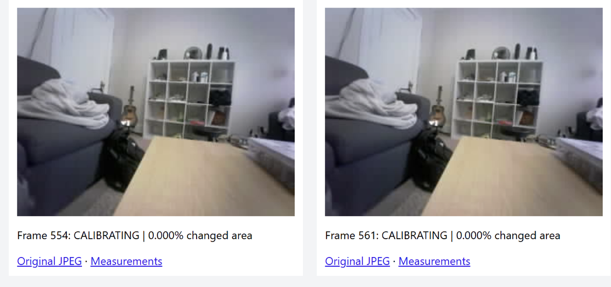
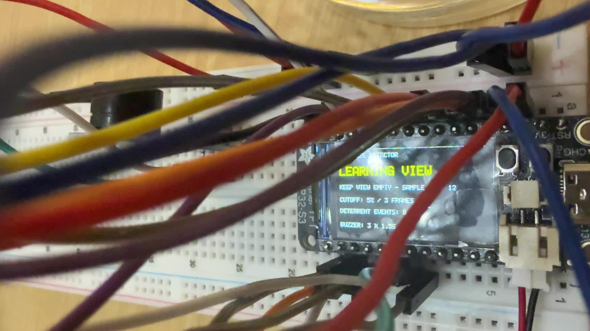
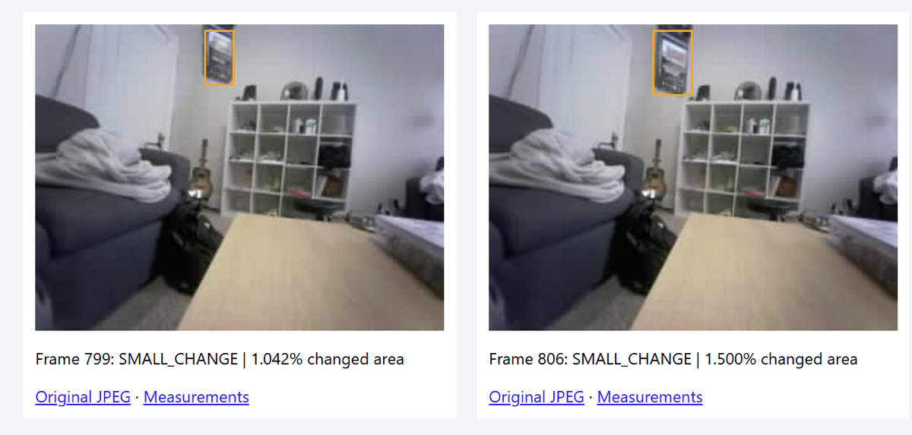
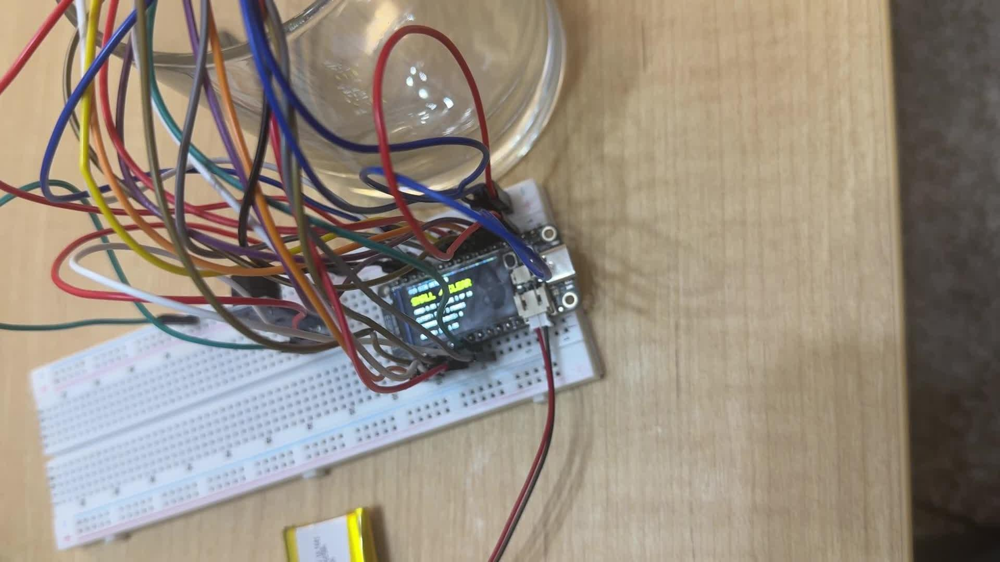
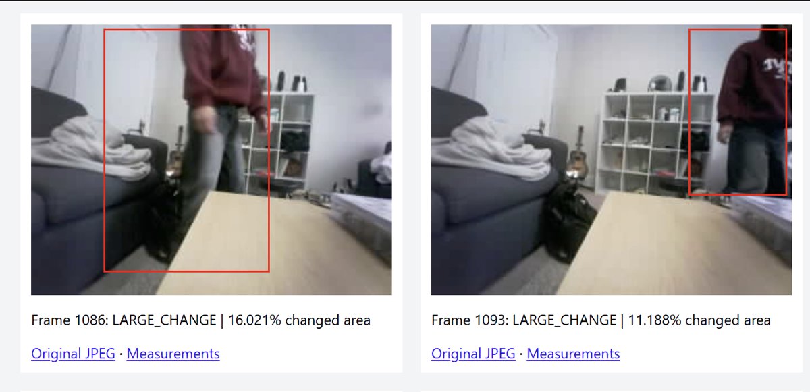
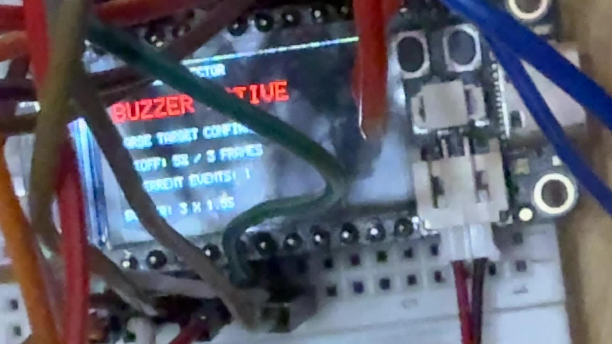
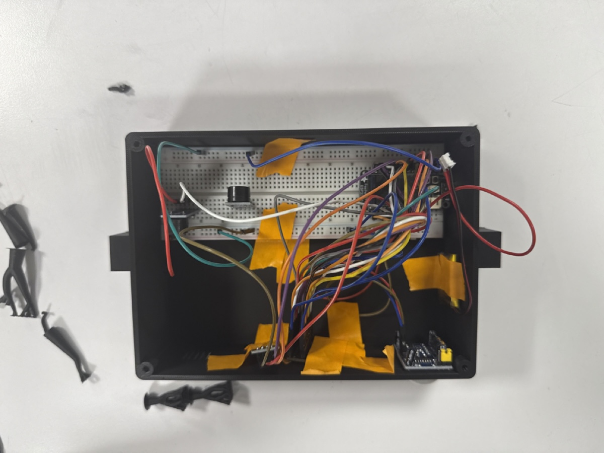
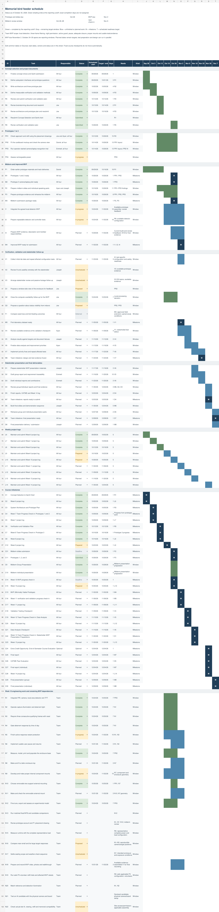
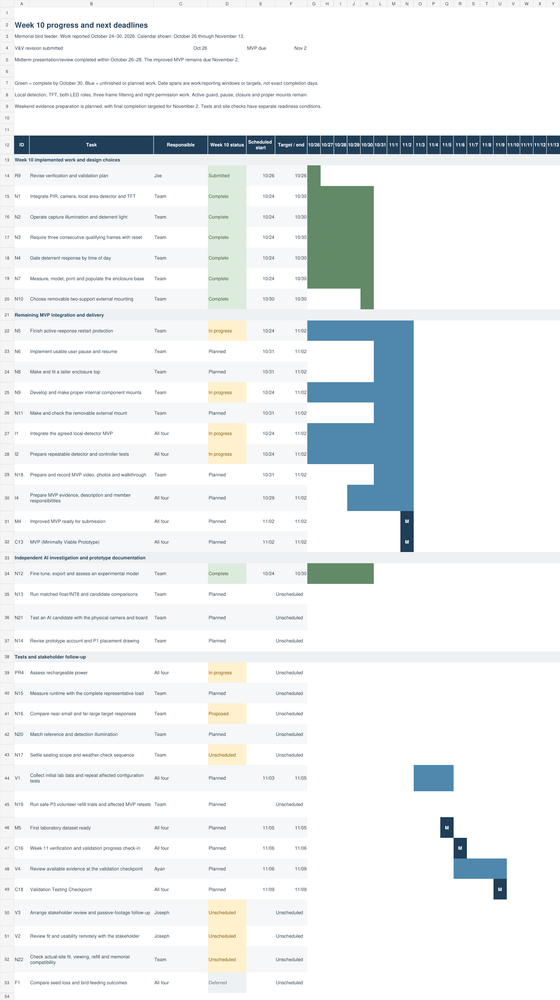

# Week 10 Project Log

**Student:** Joe Falkenburg

**Team role:** Secretary

**Teammates:** Ayan Sheikh, Emmett Gillespie, and Daniel Lim

**Project:** Bird-feeder project

**Stakeholder:** Don Fong

**Reporting period:** October 24 through October 30, 2026

## Project work · October 24–30

We developed a more integrated prototype while continuing to investigate deer recognition. Last week's camera pilot used operator-started trials and laptop inference, with PIR and TFT behavior demonstrated separately. This week the practical build joined PIR, camera capture, local image processing, onboard status, and the physical response on the ESP32-S3. The camera and outputs were already functioning subsystems; the advance was their integration into the current operating sequence.

Further model work exposed poor recognition performance, so we committed the immediate MVP to a simpler changed-image-area rule. It can reject the demonstrated small changes and respond to a large change without waiting for a deer-model verdict. This trades species selectivity for a working local decision path. Compact-model development continued alongside it.

### Integrated camera detector and controls

Camera wiring consumed much of the available pin capacity, and the crowded board made retaining the other sensors and outputs an integration problem. The current build runs the camera with the TFT and the light/buzzer response. Its normal detection path no longer requires the laptop; the computer remains useful for viewing images and diagnostic results.

At setup, the device learns a target-free view using 12 samples. PIR motion then initiates a camera check against the learned scene. Changed image area is compared with a 5% cutoff, and three consecutive qualifying frames are required before response. A below-cutoff frame resets that confirmation count. The TFT shows learning, armed, small-skip, and response states, together with an event count.

The LED now serves both capture illumination and deterrent flashing. The buzzer response uses three pulses of approximately 1.5 seconds, separated by roughly half-second gaps. Night-only operation was also completed, permitting the response during the nighttime window and suppressing it during daytime.

| Control | Status at the end of the week |
|---|---|
| Three consecutive qualifying frames before activation | Running; a below-cutoff frame resets confirmation. |
| Automatic night-only operation | Completed for the MVP. |
| Protection against restarting an active response | Required for the MVP. Connecting the active/busy condition to the detector's trigger path had begun but remained incomplete. |
| Usable pause/resume control for Mr. Fong | Required for the MVP; implementation had not started. Manual pause must override qualifying detections and the night schedule until he deliberately re-enables operation. |

The frame-confirmation rule qualifies an event before it starts. The active/busy check has a different job: preventing later detections from restarting or extending a light/buzzer sequence already running. Completing the first does not complete the second. The functioning detector and night control therefore still leave work before the full agreed MVP is finished.

### Camera results and physical demonstrations

*Empty-view calibration: the reference scene is kept clear of temporary targets while the detector learns the view.*

[View the startup and calibration demonstration](videos/week10-calibration-demo.mp4)

*The clip progresses from startup into reference learning and shows the operating settings. It ends while learning is still underway.*

*The small-object examples produce 1.042% and 1.500% changed area, below the 5% cutoff.*

[View the small-object rejection demonstration](videos/week10-small-object-demo.mp4)

*The separate physical trial ends in SMALL SKIP with the deterrent-event count still at zero.*

*A person used as a large-target proxy produces 16.021% and 11.188% changed area, above the cutoff.*

[View the large-object response demonstration](videos/week10-large-object-demo.mp4)

*The physical trial records one deterrent event and three audible buzzer pulses after the person crosses the view.*

These cases demonstrate the image-area decision and physical response. They do not establish species recognition or a field success rate. A nearby bird can occupy a large part of the view, and a person can qualify under the same rule. Camera placement, scene changes, low light, and moving background objects still need testing.

### Compact deer-model development and evaluation

We continued the compact-model direction from the earlier pilot, developing a one-class ESPDet-Pico deer-box detector for the ESP32-S3. The data preparation combined 2,581 annotated deer images with 750 negative images. Camera locations were kept separate between training and validation, giving 2,729 training images and 602 validation images. Recovering the intended checkpoints and matching data allowed a clean evaluation; image/label pairing and split separation were checked, and duplicate copies were kept out of evaluation.

We completed a compact-model fine-tuning/refinement run and produced an experimental embedded export. The retained model uses INT8 weights and a 224 × 224 input and occupies about 500 KB. The separate camera/model test application starts with 320 × 240 JPEG capture, decodes and resizes one frame at a time, uses PSRAM for image buffers, and keeps model weights in flash. This addresses the board's constrained memory without treating model-file size as its entire runtime requirement.

That standalone application compiled, but physical recognition testing of this embedded path remained ahead. It produces serial scores and detection states and is separate from the operating PIR/area-detector/light/buzzer program. Its AI confirmation rule is two qualifying frames out of three, with invalid input clearing the history; it is not the practical detector's three-consecutive-frame rule.

The restored validation set contained 517 deer images and 85 negative images. The image-level results were:

| Float checkpoint | Confidence cutoff | Deer images detected / 517 | Deer images missed | False-positive images / 85 negatives | Deer recall |
|---|---:|---:|---:|---:|---:|
| Best training checkpoint | 0.85 | 0 | 517 | 0 | 0% |
| Best training checkpoint | 0.25 | 175 | 342 | 14 | 33.85% |
| Final training checkpoint | 0.85 | 0 | 517 | 0 | 0% |
| Final training checkpoint | 0.25 | 182 | 335 | 9 | 35.20% |

Lowering confidence recovered some deer detections, but still missed roughly two thirds and introduced false positives. Threshold tuning alone did not make these checkpoints suitable for the operating prototype. Because these were saved-image tests of the float models, weak learning or data generalization must be investigated independently of physical camera capture and INT8 execution. The Week 9 pilot established nominal operation; this week's evaluation exposed recognition limits that had not yet been measured.

A separate QEMU evaluation attempt failed a known reference-model calculation: the expected value was −102, but the emulator returned the saturated INT8 value 127. The failed check ruled out using its deer-model scores as an accuracy result. We prepared tooling for a controlled float/INT8 comparison with consistent image preparation and detection decoding, and for generating numerical reference inputs and outputs for independent execution checks.

Further training tooling preserves the current baseline and writes a separate candidate, with gentler warm-up and augmentation settings and training-only quantization calibration. The next comparison must distinguish weak float predictions, additional conversion loss, and problems introduced by actual camera inputs. No improved candidate or successful matched INT8 result had been established by the end of the week.

### Housing design, fabrication, and fit

The enclosure progressed from the cardboard fit check to measured CAD and a printed, populated base. Actual component dimensions, including the 159.5 × 49 mm breadboard, informed packing space for the boards, battery, connectors, and wire bends. The initial CAD shell measured 175.5 × 127 × 36 mm with 3 mm walls. The parametric body and lid design included openings for the camera, PIR, LED, and buzzer, four lid-fastener locations, and two external support sleeves. Body and lid models were exported for fabrication.

The printed base accommodated the wired assembly, but fitting the electronics exposed insufficient height for closure. In Friday's lab, we chose to retain the full wired breadboard rather than downsize it, preserving the assembled connections and allowing the enclosure to accommodate their volume. We also chose to keep the usable base and obtain the needed clearance through a taller top. Completing that top remained ahead. Limited printing credit also affected plans for the remaining enclosure work.

*The populated printed base contains the full breadboard and wired modules. Tape provides temporary retention; the taller top and proper internal mounts remain unfinished.*

For external mounting, the chosen arrangement supports both sides and lets the enclosure slide on and off for installation and servicing. This develops the existing separate-post concept. Outdoor support fit and stability still need checking.

In lab, we discussed slots, lips, or removable retainers behind the sensor openings so the modules can be held in position and removed for service. We committed proper internal mounts to the MVP and still need to turn those ideas into detailed designs and fitted parts. Clearance around wiring and a sensor opening alone do not provide that retention.

Sealing around openings and the lid was also discussed. Changing geometry complicates fitting gaskets. We considered PLA's outdoor limitations and PETG as a possible alternative, but a material change and its outdoor suitability had not been established. Sealing was not completed, and its required scope for the immediate MVP remained undecided. The actual dimensions informed the housing CAD; updating the earlier P1 placement drawing remained a separate task.

## Verification and validation resubmission · October 26

I resubmitted the V&V plan on Monday morning. The revision updated prototype-to-test mapping, battery tests, traceability, safety, and the iteration plan, including the team-approved volunteer method for TS.05 and a separate stakeholder review.

## Testing discussions and observations · October 24–30

During the lab review, we showed the camera images and the small-object and large-target response examples. Feedback emphasized the nearby-bird problem and the need to measure false alarms. The view and mounting arrangement may help, but their effectiveness needs testing rather than assuming that birds will always remain outside the sensitive part of the image.

We discussed calibrating a stationary, target-free installed view, keeping the reference fixed during a monitoring run, and deliberately recalibrating after changing the view. The 5% cutoff is a starting point supported by the demonstrated small and large examples, not an optimized boundary. Further trials should include borderline changes, repeated cases, missed large events, and unwanted activations under comparable conditions.

Images, changed-area percentages, controller states, and physical outputs provide different diagnostic information. A missing image calls for capture debugging; a valid below-cutoff image calls for checking the scene and decision rule; a qualifying event without a response calls for checking output control. Capture delay and the additional time needed for confirmation also need to be distinguished when investigating a missed passing target. The device's own deterrent flashes are another potential source of image change to consider during further control work.

I raised the need to acquire reference and detection images under comparable capture lighting, and the team agreed. Otherwise, switching illumination on could itself dominate the comparison with an unlit reference. Checking the reference and detection sequence under matching illumination remains part of the follow-up testing.

In lab, I proposed comparing a small object at different distances with a larger proxy farther away while keeping the camera and cutoff fixed. This would test whether apparent size defeats the intended small/large distinction and help guide placement. The comparison remained proposed.

Battery-powered operation is already established, but endurance with the current capture illumination, processing, and response load still needs measurement. The planned runtime test will exercise representative idle periods, camera checks, and light/buzzer events, recording elapsed runtime and event frequency. A real feeder-outcome comparison will follow the immediate MVP to assess effects on animal visits or seed loss; the indoor demonstrations do not establish actual deterrence.

I also want to raise the connection between camera retention and the learned background. Generous room for wires can coexist with firm camera positioning: a camera that shifts inside the enclosure changes the viewpoint and can make the background look different without a new target. Mount design should therefore support a repeatable view, with recalibration after repositioning.

## Presentation, documentation, and schedule · October 24–30

Monday and Wednesday lab sessions were replaced by midterm presentations. The presentation and subsequent prototype review emphasized making each stage's purpose, test, result, and next iteration clear. We planned to revise the prototype submission around those distinctions, including actual camera evidence, the weak deer-model attempt, and the practical area-detector direction. The document revision and updated P1 drawing remained tasks.

We arranged weekend work at [Sears think\[box\]](https://case.edu/thinkbox/) to continue the assembly and prepare a short video, photographs, and a narrated MVP walkthrough. The planned sequence covers setup/calibration, small-object rejection, large-target response, and the fitted enclosure. The diagnostic recordings above are useful evidence, but the assembled walkthrough still needed preparation.

An extension was discussed because fabrication and enclosure readiness could delay recording, but no request was sent. The MVP deadline remained November 2. The schedule below carries forward the completed integration and model evaluation while keeping the active-response guard, user pause, internal mounts, taller top, demonstration package, and remaining tests visible as unfinished work.

[Editable Week 10 Gantt chart](attachments/Week10-Gantt.xlsx)

## 2026-10-30: Internal team meeting minutes

**Time:** 1:00–1:45 PM · **Platform:** Google Meet · **Minutes recorded by:** me (Joe Falkenburg), team secretary

**Attendees (all present):** Joe Falkenburg, Ayan Sheikh, Emmett Gillespie, and Daniel Lim.

### MVP direction and operating behavior

We committed the immediate MVP to local image-area detection while retaining PIR and the camera. We set aside replacing them with ultrasonic or other range sensing. Ordinary detection and response should operate without the laptop, while the computer remains available for training and diagnostics. We agreed to continue AI work without holding up the detector, enclosure, or demonstration.

We accepted the area rule as a practical proxy with limits: a person can trigger it, and a nearby small animal may appear large. We discussed calibration of a clear installed view, a provisional area cutoff, confirmation across multiple frames, reference refresh, camera aim, and capture delay as parts of making the behavior useful. The demonstration must distinguish this filtering from deer identification.

We agreed on night-only operation and a usable pause/resume control for the MVP. A deliberate pause must suppress deterrence despite qualifying images and must remain in effect when the nighttime window begins; operation resumes when Mr. Fong re-enables it. We also agreed that new detections should not restart or extend an active light/buzzer sequence. These requirements address separate stages of operation.

### Model findings and next investigation

We reviewed the completed confidence-threshold comparison: the high cutoff missed all held-out deer, and lowering it recovered some detections while still missing most. We also reviewed the confirmed numerical failure in the emulator, so its saturated scores could not be used as an accuracy result.

We discussed the recovered model/data starting point, adequate deer and non-deer examples, training/validation separation, and fitting a compact model and image buffers on the ESP32. We considered data quality and evaluation methods alongside further training. Saved-image testing, matched float/INT8 execution, and actual camera input should be investigated separately to locate the failure.

We agreed on a controlled float/INT8 comparison using the same checkpoint and consistent image preparation and decoding. Further training should preserve the baseline and produce a separately comparable candidate. Before AI replaces the practical detector, it must repeatedly detect positive cases, remain quiet on relevant empty/non-deer cases, clear when the target is removed, and operate acceptably on the board. A controlled empty-scene → deer-picture → empty-scene procedure with repeated-frame confirmation provides a starting point; passing it would permit further integration, not establish field accuracy.

### Enclosure and mounting

We reviewed the printed base's height problem and considered retaining the full wired breadboard versus downsizing it. We discussed a taller top as a way to retain the base while gaining clearance. We did not decide on either the board choice or the taller-top remedy in this meeting.

We chose the removable external arrangement with two supports. Supporting both sides should limit rocking or rotation while allowing the enclosure to slide off for installation and servicing. We discussed sealing and gaskets, but whether sealing had to be completed for the immediate MVP remained undecided.

### Tests, documentation, and coordinated work

We agreed to a representative-load battery test of the complete assembly, including idle time, camera checks, illumination, and deterrent events. Elapsed runtime and event frequency should be recorded so the result reflects how the device is used. We placed the real feeder-outcome comparison after the immediate MVP.

We agreed to revise the prototype submission to give P1, P2, and P3 distinct explanations of purpose, test, learning, and subsequent change, with actual camera and response evidence alongside the AI attempt and practical detector.

We planned a short video, photographs, and a narrated assembled-MVP walkthrough for weekend work. The walkthrough should show calibration, small-object rejection, a large-target response, and the fitted enclosure. Further AI investigation, unfinished controls, enclosure completion, and evidence preparation remain collective work toward the MVP.
