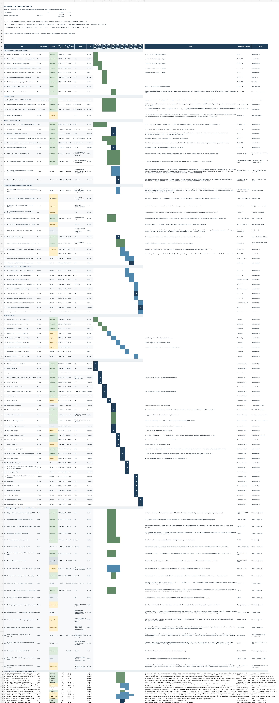
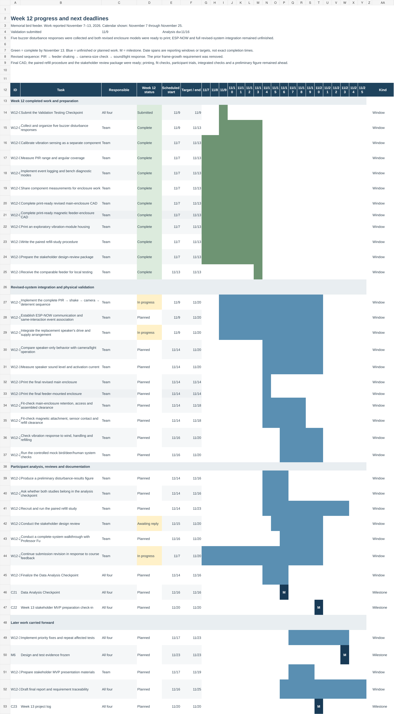

# Week 12 Project Log

**Student:** Joe Falkenburg

**Team role:** Secretary

**Teammates:** Ayan Sheikh, Emmett Gillespie, and Daniel Lim

**Project:** Bird-feeder project

**Stakeholder:** Don Fong

**Reporting period:** November 7 through November 13, 2026

## Project work · November 7–13

This week we expanded the disturbance study, changed the planned detection sequence to require feeder interaction, completed print-ready CAD for both revised enclosures, and prepared the refill and stakeholder-review work. The submitted MVP still provides the earlier PIR-and-camera approaching-object baseline. The new direction adds a feeder-mounted vibration check and changes the camera step from an approach-growth rule to a foreground-size check after feeder movement. The components and diagnostic tools progressed, but ESP-NOW communication and operation of the complete revised sequence remained unfinished.

### Revised detection sequence and component work

The agreed sequence is now **PIR → feeder shaking → camera-size check → sound/light response**. PIR motion starts the interaction window, the feeder module must then detect shaking associated with that interaction, and the camera checks for a sufficiently large foreground object before the deterrent can activate. The firmware still has to associate the PIR event, feeder movement, and camera observation so unrelated events cannot satisfy the sequence.

The camera step no longer requires the foreground object to grow across successive frames. An animal already touching the feeder may remain at roughly the same distance from the camera, so the prior growth rule could reject the interaction that the added sensor is meant to confirm. Requiring feeder contact may allow some initial access to seed, but it should reduce nuisance activations from people or animals that pass nearby without interacting with the feeder.

The vibration mechanism was tested separately and calibrated to reduce excessive noise while retaining a response to feeder movement. Its installed behavior still needs to be checked against brisk wind, ordinary handling, refilling, and deliberate contact. The PIR was adjusted and tested at measured positions, giving approximately **6 feet of range** and **120° of angular coverage**; the angular check used a protractor. These measurements provide concrete inputs for aiming the PIR and camera toward the same approach area.

The group also implemented computer-side sensor/event and activation logging and used it in trials. Bench diagnostic work separated PIR behavior, PIR-triggered camera capture, and output testing so component problems can be distinguished from failures of the full sequence. Those tools do not establish end-to-end operation. The two-controller ESP-NOW link, peer/access checks, event association, and full integration remain ahead.

The controlled mock bird/deer/human checks were planned but not performed this week. A person will supply repeatable inputs by passing nearby without contact, contacting or shaking the feeder, attempting to take seed, and allowing the group to check whether the outputs activate under the intended conditions and stop correctly. These are system-operation checks, not evidence that the device deters real deer.

### Speaker troubleshooting and planned measurements

The replacement 8-ohm speaker worked in a standalone bench test, but its behavior became intermittent when it was incorporated with the other system components. The group discussed inadequate drive and effects from components sharing the supply as possible explanations. Additional amplification, discussed as a possible op-amp stage, remained a candidate remedy rather than a diagnosed requirement or settled circuit change.

A comparison between speaker-only operation and operation alongside the camera or lights was discussed but not carried out. The planned follow-up also includes a phone-app sound-level comparison between the speaker and the original buzzer and a measurement of current draw during activation. Those measurements will help separate sound-output performance from battery and shared-supply demands.

### Enclosure measurements, CAD, and fabrication status

The group measured and shared the components that govern the revised enclosure designs.

| Item | Measurement | Design use |
| --- | ---: | --- |
| Breadboard arrangement | 91 × 63 × 27 mm | Main-enclosure volume and retention |
| Vibration module | 55 × 21 × 10 mm | Feeder-node space and retention |
| LED board | 15 × 19 mm | Internal support and clearance |
| LED projection | 9 mm relative to its cutout | Front-panel clearance |
| PIR board | 33 × 19 mm | Support behind the sensor opening |
| Camera board | 23 × 35 mm | Support behind the camera opening |
| Battery | Additional clearance required | Space for the battery and connections |

The revised main-enclosure CAD was completed and ready to print. It reduces the footprint while retaining enough height for the camera and PIR to remain close together in a vertical arrangement. The model incorporates internal clips or supports for the actual boards, preserves suitable exterior apertures while accounting for the larger board bodies behind them, provides clearance for pins, connectors, wiring, the LED projection, and the sound-output arrangement, improves the lid and assembled fit, adds USB access, and retains the existing dowel arrangement.

The final feeder-mounted enclosure CAD was also completed and ready to print. It uses two magnets to clamp the housing beneath the feeder base, with one magnet inside the feeder and the other outside. The design includes battery space, firm sensor-to-feeder contact, removability for servicing, and clearance for normal refilling. The final magnetic version had not yet been printed or physically fit-tested.

An earlier exploratory vibration-module housing was printed during the week. That print was an initial trial, not the final two-magnet feeder-mounted design. The final models still need fabrication and checks with the actual electronics and feeder, including board retention, lid and USB access, magnetic holding strength and slipping, sensor contact, battery clearance, servicing, and the refill routine.

The comparable feeder for local testing arrived at **6:00 PM** during the reporting period. It is now available as the physical fixture for enclosure fit work and the paired refill study; its arrival does not divide the other weekly work into before-and-after phases.

### Disturbance testing and data preparation

The Validation Testing Checkpoint was submitted with one completed response from the original buzzer configuration. Four additional responses were collected afterward without resubmitting the checkpoint, bringing the weekly total to **five unique completed responses**.

Each volunteer outside the design team observed the device through a glass barrier from approximately two feet away. The test program presented sound only, light only, and sound and light together for 15 seconds each, for a 45-second sequence. Participants rated each condition on the existing 1–5 scale from not bothersome to intolerable.

The five responses were consolidated and organized by output condition. No preliminary figure had been produced by the end of the reporting period. The recorded buzzer ratings remain the data from the configuration participants actually experienced; the stronger replacement speaker requires separate disturbance evidence rather than changing the existing responses.

The study addresses human disturbance, not detection accuracy, sound level, light intensity, deer hearing, or actual deterrence. Its interpretation is also limited by remaining ambient light, the Glennan glass and acoustics, participants imagining the nighttime residential setting, the convenience sample, and participants' familiarity with the team.

### Paired refill study and written procedure

The group prepared a trial-ready paired procedure for the refill study. Each participant will use the same comparable feeder in two conditions: the feeder alone and the feeder with the shake-sensor package attached. The task represents taking down, opening, refilling, closing, and rehanging the feeder while the main unit remains separate in its intended position.

At the detailed-log level, the written procedure establishes the setup and materials, consistent and neutral participant instructions, paired participant and condition-order records, the completion, effort, error, assistance, and perceived-difficulty measures, the observation and survey recording method, and the installed configuration that must be documented. This describes the procedure's completed scope without attempting to reproduce its exact wording, forms, questions, or scoring rules.

The goal remains about ten volunteers outside the design team. Recruitment and trials had not begun by the reporting cutoff. The physical usability study does not require the ESP-NOW link to be finished, but the installed package must represent the actual handling being evaluated. Printing and fit-checking the final feeder enclosure therefore remain part of study readiness.

### Stakeholder review, analysis, and revision work

The group completed the guided-review package for Mr. Fong, including the review structure, supporting visual material, and concluding survey. The invitation had been sent and a reply was still pending. The proposed availability was Sunday from noon to 6 PM, but no meeting time had been agreed. The review is intended to address the enclosures' appearance and prominence, visibility of the feeder and memorial panel, the magnetic attachment, refilling and servicing access, charging, and the intended detection and sound/light behavior. The completed package does not imply that the final enclosures had already been printed or photographed.

A separate complete-system walkthrough with Professor Fu remained planned. The group also agreed to ask whether both the disturbance and refill studies should be included in the Data Analysis Checkpoint, but had not yet asked by the end of the week. The five disturbance responses were organized, while the preliminary figure and refill dataset remained ahead.

The group continued revising the submission in response to Professor Fu's feedback. That revision remained in progress; the detailed deficiencies, feedback items, and edits are intentionally not expanded here.

## Where the week left the project

The week moved the project from an approaching-object-only rule toward an interaction-gated detector. That change gives the system another way to reject passersby, but it also shifts the immediate risks to wireless integration, reliable transfer of feeder movement into the sensor, speaker drive and supply behavior, physical fit of the two new enclosures, and evidence from the planned participant and stakeholder work.

The group ended the week with the vibration component, PIR measurement, logging, five-response disturbance dataset, both final CAD models, refill procedure, stakeholder-review package, and comparable feeder ready at their respective preparation stages. The complete ESP-NOW sequence, final prints and fit checks, integrated speaker work, controlled proxy trials, paired refill trials, preliminary figure, stakeholder review, and Professor Fu walkthrough remained open.

## Gantt update

The updated schedule records the practical pivot rather than carrying the old plan forward unchanged. Independent classifier comparison and physical AI-candidate qualification are deferred because they no longer gate the practical detector. The earlier taller-top remedy is superseded by the compact main-enclosure redesign. The schedule now tracks the vibration-gated sequence, ESP-NOW integration, final enclosure printing and fit checks, speaker troubleshooting, disturbance analysis, paired refill study, stakeholder review, and the remaining course milestones.

[Editable Week 12 Gantt chart](attachments/Week12-Gantt.xlsx)

## 2026-11-13: Internal team meeting minutes

**Time:** 1:00–1:45 PM · **Platform:** Google Meet · **Minutes recorded by:** me (Joe Falkenburg), team secretary

**Attendees (all present):** Joe Falkenburg, Ayan Sheikh, Emmett Gillespie, and Daniel Lim.

### Detection logic and integration

We agreed that deterrence should require the sequence PIR → feeder shaking → camera-size check → sound/light response. The PIR initiates the check, the feeder-mounted sensor confirms interaction, and the camera then checks for a sufficiently large foreground object. Each stage is required. We discussed making sure the events belong to the same interaction so unrelated detections cannot satisfy the sequence.

We removed the requirement that the object grow across successive camera frames. An animal already at the feeder may cause shaking while remaining at roughly the same distance from the camera. Requiring feeder interaction may allow some initial seed access, but we accepted that tradeoff to reduce nuisance activations from people or animals passing nearby without interacting with the feeder.

The revised sequence still needs to be implemented and integrated. Daniel leads the firmware and electronics work, with Joe supporting the code. Connecting the feeder controller to the main controller through ESP-NOW remains part of that work; successful component operation does not yet establish operation of the complete sequence.

### Sensor calibration and system testing

We discussed narrowing the PIR's useful detection area around the feeder and checking its boundary at measured positions. The purpose is to reduce responses to passersby while retaining coverage of the intended approach area. We also discussed the vibration sensor's calibration goal: reducing excessive noise while preserving a useful response to feeder shaking.

We planned to check the shake sensor's response to brisk wind and to ordinary handling and refilling. These checks should help distinguish intended feeder interactions from environmental movement and normal use.

We noted that sensor/event and activation logging had been implemented and used in trials. We planned controlled checks in which a person passes nearby without touching the feeder and attempts to take seed from it, allowing us to compare a nearby movement with an actual feeder interaction. We also planned to check that the sound and light stop correctly after activation. These trials will check system operation; they will not establish deterrence of real deer.

### Speaker integration and measurements

We reviewed the replacement speaker's standalone operation and the intermittent results encountered when incorporating it into the system. We discussed inadequate drive and shared-supply behavior as possible explanations. Additional amplification, potentially using an op-amp stage, was considered as a way to provide adequate drive for the 8-ohm speaker. The cause of the intermittent behavior and the final drive and supply arrangement remained unresolved.

We discussed comparing speaker-only operation with operation alongside the camera or lights to investigate whether combining components affected reliability. This comparison had not yet been carried out. We also planned to compare sound levels from the speaker and buzzer using a phone app and to measure the speaker's current draw during activation to assess battery demand.

### Enclosure design and printing

We agreed on a more compact main enclosure while retaining the height needed to place the camera and PIR close together vertically, aimed toward the same approach region. Joe will develop the main enclosure using the shared component measurements and our group's existing CAD as reference. The board dimensions need to inform internal retention and clearance separately from the exterior openings. The design should secure the boards, allow space for wiring and connections, improve the lid's fit, provide USB access, and retain the existing dowel arrangement.

Emmett will develop the feeder-mounted housing and its attachment. We selected a removable two-magnet clamp beneath the feeder base, with one magnet inside the feeder and the other outside holding the base and housing together. The package must accommodate its battery and hold the sensor firmly against the feeder so movement reaches it. The magnetic arrangement has been selected but still needs a physical check for holding strength, slipping, clearance, and removal for servicing. Its position must also preserve access for normal refilling.

Ayan will print both revised enclosures on Saturday. The CAD handoff needs to incorporate the measured components and their mounting and clearance requirements. Fit checks remain shared work: the printed parts must be checked with the actual electronics and feeder, including board retention, access, and the assembled mounting arrangement.

### Disturbance testing and interpretation

We reviewed the five complete disturbance-survey responses collected using the original buzzer. Each participant experienced sound only, light only, and sound and light together for 15 seconds per condition, then rated each mode on the existing 1–5 disturbance scale. The setup used a glass barrier and an observer approximately two feet from the glass to approximate the intended indoor viewing situation.

We agreed to retain the recorded buzzer ratings unchanged. They describe the configuration that participants experienced; the replacement speaker requires separate disturbance evidence. The participant test program exercises the outputs directly, so these responses concern human disturbance rather than the integrated detection sequence or effectiveness against deer.

We discussed the limits of the setup and sample. Some ambient lighting remained, the room's glass and acoustics differ from Mr. Fong's setting, and participants were asked to imagine the nighttime residential situation. The convenience sample and familiarity with the team also affect how broadly the findings can be applied.

### Refill study and testing procedure

We agreed on a paired refill study using the comparable feeder ordered for local testing. Each participant will complete the task with the feeder alone and with the shake-sensor package attached. The task should represent taking down, opening, refilling, closing, and rehanging the feeder, with the main unit remaining separate in its intended position. This comparison will assess whether the added package interferes with normal handling.

The recruitment goal is about ten volunteers outside the design team. Each person's two conditions must remain paired; this is a comparison of the same participants using both configurations. Recruitment and trials still need to be arranged. The physical usability study can proceed before ESP-NOW is finished, provided the attached package represents the housing and mounting arrangement being evaluated and that configuration is recorded.

Joe's refill procedure is the priority for the validation-testing manual. We agreed that the manual must make the study executable through consistent setup and task instructions, participant and condition records, and a defined recording method. It must specify how completion, efficiency or effort, errors, assistance, and perceived difficulty will be assessed before those measures are used. No refill results have been collected yet. Little or no added difficulty would still be a useful finding because the study is checking whether the installation preserves the normal refill routine.

### Reviews, analysis, and revision work

We planned a guided review of the revised installation with Mr. Fong. Joe will prepare the script, supported by photographs or video and a concluding feedback survey. The review should address the enclosures' appearance, feeder visibility, mounting, and access for refilling, servicing, and charging in his setting.

We discussed the invitation already sent to Mr. Fong and the pending reply. The proposed Sunday availability was noon–6 PM; no specific time had been agreed. We also planned a separate complete-system walkthrough with Professor Fu to obtain overall design and implementation feedback.

We planned to prepare at least one interpretable figure from the participant results for the data-analysis checkpoint. We agreed to ask Professor Fu to clarify whether both the disturbance and refill studies should be included.

We discussed ongoing revision work in response to Professor Fu's feedback.
