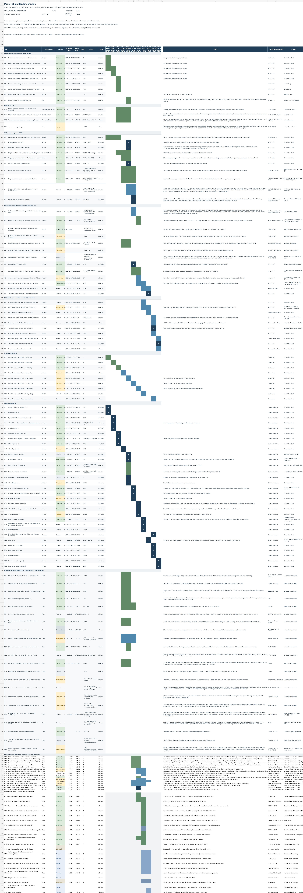
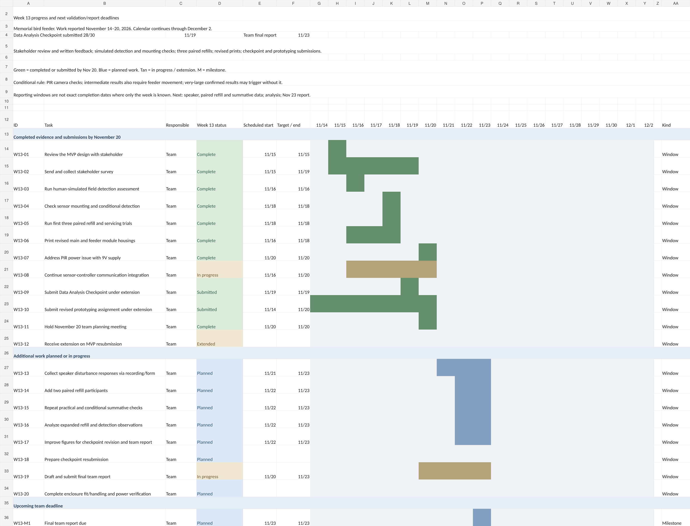

# Week 13 Project Log

**Student:** Joe Falkenburg

**Team role:** Secretary

**Teammates:** Ayan Sheikh, Emmett Gillespie, and Daniel Lim

**Project:** Bird-feeder project

**Stakeholder:** Don Fong

**Reporting period:** November 14 through November 20, 2026

## Project work · November 14–20

This week our project advanced from preparing validation procedures and components to gathering evidence about the detector, the refill and servicing routine, and stakeholder acceptance. We completed the Data Analysis Checkpoint under an extension, submitted the revised prototyping assignment, and continued work on the assemblies needed for testing. We also held the November 15 stakeholder review and November 20 internal meeting. The narrative below documents the work and observations from the week; the two sets of minutes, included afterward, record the discussions, feedback, decisions, and plans in full.

### Detection-system assessment and follow-up

On **November 16**, the group carried out a human-simulated assessment in a setting representing the intended feeder installation. A participant enacted three scenarios: a bird feeding, a person walking past without feeding, and a deer reaching into and disturbing the feeder. The deterrent correctly remained inactive in two bird-feeding and two passerby trials. The deer-feeding scenario was less consistent. After earlier nonresponses, a continuing interaction produced automatic light-and-sound responses under adjusted conditions; the two recorded output occasions were part of that interaction, not two independent successful trials. Camera sensitivity, vibration sensitivity, participant position, shaking, and power conditions changed during the assessment. We therefore demonstrated an automatic response, but could not isolate the change responsible or calculate a meaningful success rate from the incomplete attempt count.

The **November 18** follow-up examined the repackaged, direct-contact feeder-mounted vibration assembly and the conditional decision rule. The simulated bird-feeding and walk-by conditions remained quiet, while qualifying simulated deer feeding activated the outputs. The group also checked the logic behind those outcomes: an intermediate camera result alone produced no deterrence, a comparable result accompanied by feeder movement produced light and sound, and a very-large qualifying camera result could activate the outputs without a movement signal. These six documented outcomes describe **six conditions, not six scored trials**. They support the observed operation of the revised arrangement, while leaving repeated performance rates and long-term reliability unmeasured.

### Paired refill and charging-related handling study

The group prepared the comparable feeder and birdseed for the **November 18** handling study. Three campus volunteers each refilled the feeder with both system units installed and with them removed. They also practiced removing the mechanism for charging and reattaching it afterward. Completion times, ease ratings, and optional participant comments were recorded. Since each volunteer completed both refill conditions, the comparison is the difference within the same person.

| Participant | Refill installed | Refill removed | Added time | Removal for charging | Reattachment |
| --- | ---: | ---: | ---: | ---: | ---: |
| H1 | 45 s | 31 s | +14 s | 58 s | 36 s |
| H2 | 40 s | 39 s | +1 s | 47 s | 35 s |
| H3 | 27 s | 28 s | −1 s | 27 s | 25 s |

The installed configuration added **4.67 seconds on average**, compared with the five-second mean target, but the sample consisted of only three paired observations and the differences varied considerably (**+14, +1, and −1 seconds**, with a sample standard deviation of **8.14 seconds**). The median added time was **+1 second**. All six refill ease ratings were **5/5, very easy**, while removal for charging was slower than reattachment for every participant and received lower ease ratings. A participant also expressed concern about pulling on the wire and damaging the board during removal. Together, the results suggest that normal refilling may remain manageable, while the charging-related handling interface warrants further attention. The three-person study was useful preliminary evidence, not completion of the planned five-participant acceptance procedure.

### Assembly, integration, and test readiness

The group continued connecting the feeder-mounted vibration-sensor controller to the main camera controller and preparing the physical system for testing. The revised main enclosure and the vibration-sensor housing were printed during the week, building on the two enclosure models prepared earlier. The team also addressed the PIR power problem using a **9V supply**. These are group-level implementation and troubleshooting developments, not claims of measured battery endurance, fully characterized wireless reliability, or successful field deterrence of wildlife. The testing above establishes what was observed in the configurations used, rather than certifying every intended operating condition.

### Stakeholder validation and written follow-up

We held the **November 15** MVP design review with Mr. Fong over Zoom, with all four team members present. The presentation, demonstrations, design tradeoffs, and Don's feedback are documented in the stakeholder minutes below rather than retold here.

After the meeting, I emailed Mr. Fong the feedback form we had agreed to send. His written survey responses gave the proposed MVP **10/10 in four categories**: appearance, core functionality, fit to his needs, and the direction of planned iterations. He praised the quality of the printed enclosure, valued the vibration sensor's role in distinguishing feeder interaction from unrelated movement, supported improving the sound output, and expressed confidence in the direction of the design. These were four judgments from **one stakeholder**, not four separate participant responses. The ratings supplement the discussion recorded in the meeting minutes; neither constitutes a real-deer effectiveness or overnight seed-loss measurement.

### Checkpoint, resubmissions, and final-report readiness

Because I was ill, the group received an **extension for the Data Analysis Checkpoint**. We completed and submitted the checkpoint, bringing together the simulated field assessment, the November 18 mounting follow-up, the three-person handling study, stakeholder feedback, the organized data, preliminary figures, connections to design specifications, and limitations. It received **28/30**. The group's review of Professor Fu's feedback and its agreed plan to resubmit with additional validation evidence and stronger analytical figures are documented in the November 20 minutes; the same figure improvements were intended for the final report.

We also **submitted the revised prototyping assignment within its extension period**. Separately, we received an **extension for the MVP resubmission**; no completed MVP resubmission is recorded for this reporting period. These milestones reflect what was submitted or extended this week, without revisiting the earlier assignment history.

A shared working document for the final team report was established, providing a place to bring together existing material and the forthcoming validation results. The **team report deadline was Monday, November 23**. The **November 20** internal meeting established the remaining validation and reporting direction; the decisions and reasoning are recorded in full in the minutes below.

## Where the week left the project

The week produced three complementary kinds of evidence: **observed system behavior under simulations, measured handling times and ease ratings, and the owner's evaluation of the proposed design**. Each answers a different question. The favorable stakeholder response does not substitute for measured field effectiveness; the simulated detections do not establish real-deer deterrence; and the near-target average refill time remains uncertain with only three paired participants and a comparatively wide spread of differences. Our next work was therefore directed toward strengthening those specific gaps, with the distinction between **completed Week 13 evidence** and **planned follow-up work** maintained in both the November 20 minutes and the Gantt schedule.

## Gantt update

The Week 13 Gantt records the completed stakeholder review, field and handling studies, enclosure and integration progress, and course-submission activity described above. It carries forward unfinished integration and battery qualification work and separates the additional validation and report preparation discussed on November 20 from activities already completed by the reporting cutoff. The workbook preserves the earlier Week 12 focus sheet, adds a Week 13 focus sheet, and updates the full schedule. The **team final-report deadline is November 23**; the existing separate individual-report date is retained because no new date was confirmed.

[Editable Week 13 Gantt chart](attachments/Week13-Gantt.xlsx)

## 2026-11-15: Stakeholder MVP Design Review Minutes

**Project:** Memorial bird-feeder deer deterrent  
**Date:** Sunday, November 15, 2026  
**Time:** 5:00–5:45 PM  
**Platform:** Zoom  
**Attendees:** Don Fong (stakeholder), Joe Falkenburg, Ayan Sheikh, Emmett Gillespie, and Daniel Lim (all present)  
**Minutes recorded by:** Joe Falkenburg, team secretary

### Purpose and material presented

We met with Mr. Fong to review the progress of the bird-feeder deterrent, demonstrate the current prototype's appearance and operating behavior, and assess whether the design direction continued to address his needs. We connected the current minimum viable prototype (MVP) to the concepts previously presented to him and explained why the practical system uses changes in camera image area to identify possible feeding activity rather than a deer-specific image-recognition model.

We showed photographs and videos, rather than handling a physical prototype together. The material included top, front, and side views of the primary enclosure with its lid on and off; an assembled-device walkthrough showing the outward-facing camera, motion sensor, light, sound output, and mounting arrangement; and illustrations comparing the camera's response to a person-sized foreground change with a much smaller object used as a proxy for a small animal. We also showed prototype and MVP demonstrations, including an end-to-end operating sequence in which PIR motion initiated camera evaluation and a qualifying detection automatically triggered the flashing light and buzzer. We explained what those demonstrations established about the device's operation and what they did not establish about actual wildlife deterrence.

The updated feeder-mounted vibration subsystem was presented through photographs, video, and an explanation of its proposed arrangement and operation, rather than as a completed vibration-integrated sequence in the demonstration video. The group described the further development needed to incorporate that sensing into the overall detection process.

### Detection approach and interaction-based corroboration

We explained how the PIR sensor initiates camera observations and how multiple images are compared with a reference scene to evaluate the size of a changed region. The camera assesses visual change rather than identifying the species of an animal. The proposed additional vibration sensor attaches beneath the feeder and supplies evidence that the feeder itself is being disturbed. The team described the conditional decision rule: an intermediate camera result requires feeder-movement corroboration, while a sufficiently large confirmed camera result can authorize the deterrent without a vibration signal.

Mr. Fong responded positively to adding the vibration information. He appreciated the distinction between something large appearing near the camera and something actually interacting with the bird feeder, and recognized that conditional sensing could avoid unnecessary operation and conserve battery energy.

We also discussed the rule's limitations and tradeoffs. Ordinary birds and wind can move the feeder, so movement alone cannot reliably identify unwanted feeding. The very-large camera-only branch retains a possible route to unwanted activation, while requiring feeder interaction for other cases may allow a deer some initial access to seed before the deterrent responds. These considerations informed the group's aim of reducing nuisance activations without overlooking relevant interactions. We emphasized that the proposed combined behavior would need further validation.

### Enclosure, memorial preservation, and ordinary use

We presented how the ground unit would sit separately from the bird feeder and how the feeder-mounted vibration housing would attach removably beneath it. The team explained the magnetic mounting approach, access for recharging and servicing, and the intention to retain the owner's normal routine of removing, refilling, and rehanging the feeder. Preserving the memorial feeder's appearance, its inscription, and its original materials remained central to the installation approach.

Mr. Fong described the printed primary enclosure as attractive and professional-looking. He responded favorably to the overall physical presentation and acknowledged the removable feeder-unit concept. The remote review did not constitute a physical fit or handling test on his actual feeder; the group's planned validation would examine those practical aspects separately.

### Sound, light, and household disturbance

We demonstrated the deterrent's light-and-sound response using the original buzzer and made clear that a replacement speaker was being developed to improve the sound output. Mr. Fong heard the buzzer and considered the demonstrated sound level **tentatively acceptable**. He wanted to understand how the sound would be experienced through the wall separating the outdoor feeder from the inside of his home before reaching a firmer conclusion. He also raised the desirability of balancing sufficient sound to discourage deer against the possibility of disturbing sleeping occupants, including whether volume could be adjusted.

We described encouraging preliminary disturbance-test observations made with a barrier approximating an indoor viewing or listening situation. We recognized that those results provided only a preview: the acoustic conditions at his home and the replacement speaker still required separate consideration. The discussion supported continued evaluation of both perceived disturbance and potential deterrent effectiveness without treating either as proven by a demonstration.

### Nighttime operation and outdoor conditions

Mr. Fong explained that dependable ambient lighting near the feeder is limited at night. We discussed the camera's low-light requirements and possible ways to provide illumination for observation without unnecessarily operating the deterrent. The group also discussed intended nighttime-only deterrence and the need for daytime suppression; these operating controls remained part of the planned design rather than an implemented capability of the revised configuration being reviewed.

We considered the suitability of the enclosure for outdoor placement. Mr. Fong noted that an outdoor-ready version would need protection against rain, including effective sealing around the housing. We treated this as an important design consideration separate from the favorable appearance of the current prototype.

### Feedback, validation limits, and follow-up

Mr. Fong expressed a favorable overall view of the design direction, particularly its appearance and the additional effort to distinguish actual feeder interaction from unrelated motion. His evaluation concerned the materials and operation presented and the changes explained; it did not establish real-deer retreat, measured reduction in seed loss, independent operation over a full night, or fit and handling on his actual feeder.

We agreed to send Mr. Fong a follow-up survey so that he could provide written feedback on the system, its appearance, its usefulness, and the planned iterations. We also discussed keeping him informed of subsequent testing and design progress, with the possibility of an additional review if useful. No further meeting was fixed during this discussion.

## 2026-11-20: Internal Team Meeting Minutes

**Project:** Memorial bird-feeder deer deterrent  
**Date:** Friday, November 20, 2026  
**Time:** 4:15–approximately 5:00 PM  
**Platform:** Google Meet; Joe Falkenburg and Ayan Sheikh met together in person, while Emmett Gillespie and Daniel Lim joined remotely  
**Attendees:** Joe Falkenburg, Ayan Sheikh, Emmett Gillespie, and Daniel Lim (all present)  
**Minutes recorded by:** Joe Falkenburg, team secretary

### Validation progress and checkpoint feedback

We reviewed the week's validation evidence and the Data Analysis Checkpoint feedback. The submission received **28/30**, with additional validation data identified as an opportunity to strengthen the evidence. We agreed to collect further observations, refine the analysis and figures, and prepare a resubmission of the checkpoint. The same improvements would provide a stronger foundation for the final team report. We distinguished completed tests from additional observations still planned and focused on evidence that would support interpretable conclusions rather than on demonstration alone.

### Expanding sound-and-light disturbance responses

We planned a recorded demonstration of the replacement speaker and light outputs, arranged with a wall or glass barrier to approximate the through-glass disturbance-testing setting. The recording would accompany a Google Form distributed by link or QR code to make collecting additional participant ratings easier. The planned survey would retain the basic comparison of sound alone, light alone, and the combined output. These additional responses would complement the earlier buzzer study while documenting the configuration participants actually evaluated; the different playback and listening conditions would not themselves establish a controlled sound-level comparison.

### Additional summative detection assessment

We discussed expanding the summative assessment in two complementary ways. First, the team would repeat practical simulations of a bird feeding, a person passing without interacting with the feeder, and a deer attempting to feed. These scenarios assess whether ordinary bird use and nearby human activity remain quiet while qualifying feeder interaction produces the intended response. Second, we would exercise the system's conditional decision logic: intermediate camera evidence without and with feeder movement, and very-large confirmed camera evidence that can activate independently of a movement signal. The purpose was to investigate the reasons behind correct and incorrect responses, not just show that the deterrent can activate.

We considered the competing risks of false activations and missed feeding interactions, including the separate camera-only path for very-large visual changes. We also discussed how calibration choices influence sensitivity: preliminary tuning can address unreliable behavior, but settings and test arrangements should then be held consistent for scored repetitions so that outcomes are comparable. Representative low-light conditions are important to the intended nighttime use, while controlled lighting and recorded conditions improve repeatability. Testing multiple branches broadens coverage, whereas sufficient repetitions of each condition are needed to establish meaningful counts and potential rates of correct activations, misses, and false activations. The group intended to balance those needs in the additional tests and record the conditions and outcomes clearly.

The additional summative work remained planned. Human simulation and sensor/output observations can support assessment of the system's operation but do not by themselves measure deer retreat or overnight seed protection.

### Paired refill and servicing validation

We reviewed the paired refill and servicing evidence already collected. Three participants had each completed a refill with the mechanism installed and a refill with it removed, alongside the removal and reattachment tasks associated with charging. We planned to recruit two more paired refill participants, bringing the sample to five, and to retain consistent task definitions, completion times, condition labels, and ease ratings. Refilling and battery servicing would continue to be interpreted as distinct aspects of usability.

We discussed examining each participant's difference between the installed and removed refill times rather than relying solely on a single average. With the expanded dataset, we planned additional statistical analysis, including consideration of a paired t-test, while accounting for participant-to-participant variation and the small sample. The objective was to determine how much the installed mechanism affects the owner's usual handling routine and which portions of servicing may need improvement.

### Analytical figures for the checkpoint and final report

We discussed Professor Fu's feedback on making the evidence more informative through analytical visualization. We agreed to strengthen figures **in both the Data Analysis Checkpoint resubmission and the final team report**. Candidate displays included paired refill-time comparisons; box-and-whisker plots and other presentations of means, medians, and variability; comparisons of ease ratings across refill and servicing tasks, including a radar-style summary; sound-and-light disturbance-rating comparisons; and summative detection charts distinguishing correct activations, missed detections, and false activations. Setup photographs and diagrams would clarify how the observations were collected.

The aim was to make the findings and their interpretation visible, not merely re-express a data table graphically. We discussed retaining meaningful sample sizes and statistical context so the figures would not imply stronger conclusions than the testing supported. These figures were planned for the expanded evidence; their final form would depend on the additional data obtained.

### Stakeholder feedback and limitations

We considered the stakeholder design review as complementary validation evidence. Mr. Fong responded favorably to the enclosure's appearance and to using feeder interaction to supplement the camera, while his comments on sound, maintenance, and operating conditions provided priorities for further evaluation. We discussed the distinction between stakeholder approval of the proposed approach and independent measurements of system effectiveness.

We also considered limitations of the present evidence: small participant samples, simulated rather than real wildlife interactions, variation in environmental lighting, and earlier testing in which several conditions changed while the detection behavior was being refined. These limitations reinforced the need for better-documented repetitions, additional participants, and conclusions matched to what each study actually measures.

### Final-report preparation and evidence organization

We planned the final team report for **Monday, November 23**. The group would begin transferring established material into the working report, including project motivation, the design approach, the experimental setups and data-acquisition methods, relevant stakeholder context, and connections between the tests and the functional and technical specifications. Updated analyses, figures, findings, and conclusions would follow as the additional results became available. The intention was to build on the established work rather than substantially change the project's direction.

We also discussed keeping the evidence included with the submission accessible through relative paths to packaged media and data rather than relying on external cloud links. That organization would allow the supporting material to remain available to reviewers independently of personal sharing permissions.
