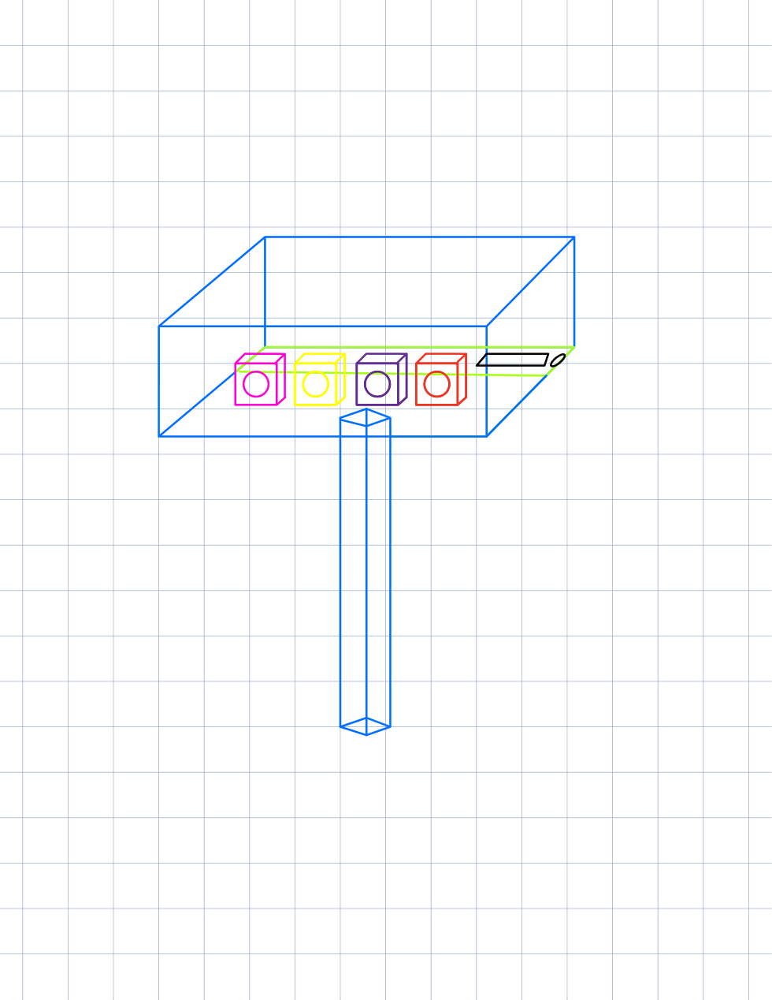
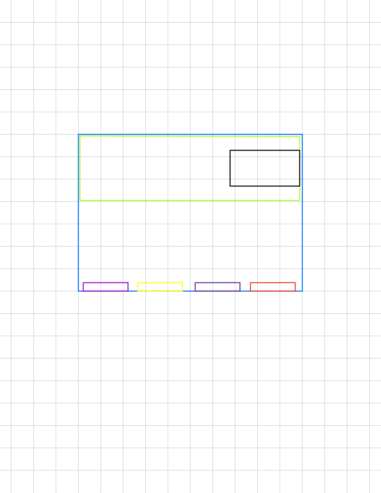
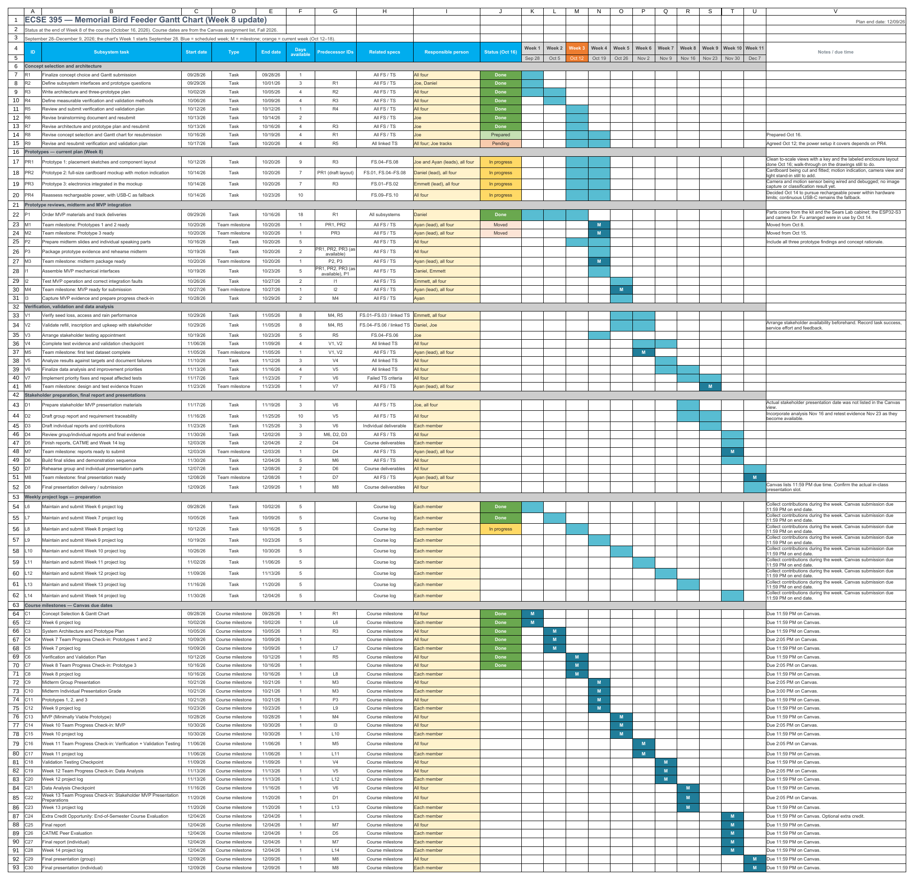
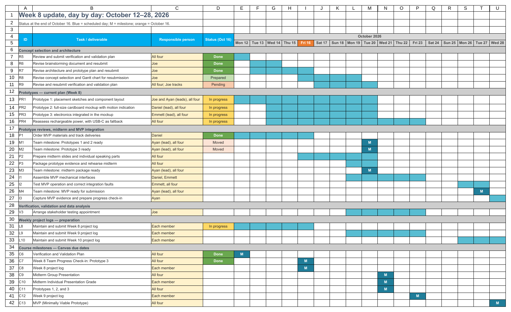

# Week 8 Project Log

**Student:** Joe Falkenburg

**Team role:** Secretary

**Teammates:** Ayan Sheikh, Emmett Gillespie, and Daniel Lim

**Project:** Bird-feeder project

**Stakeholder:** Don Fong

**Reporting period:** October 10 through October 16, 2026

## Individual contributions

### 2026-10-12 from 10:30 to 11:15 AM: Internal team meeting and minutes

I attended our meeting on Zoom with all four of us present, and as secretary I took the minutes included below. We divided the Verification and Validation (V&V) Plans, which were due that night: I took Sections 0.1 and 0.2, Emmett 0.3 and 0.4, Daniel 0.5 and 0.6, and Ayan 0.7 through 0.9. We also set who would lead each prototype. Ayan and I took Prototype 1, the placement and layout drawings; Daniel the cardboard mockup for Prototype 2; and Emmett the electronics for Prototype 3.

Since the mockup and the electronics both build on the drawings, we worked out what the drawings had to settle: where the feeder sits relative to the window, the equipment's footprint, what the camera sees, and the room needed to refill the feeder and service the system. We left mounting and clearance for the afternoon lab.

### 2026-10-12: Placement prototype in lab

All four of us attended Monday's lab, where we settled the morning's mounting question by putting the enclosure on its own pole behind the feeder, between the feeder and the house. That way the camera stays fixed when the feeder moves or comes down, and the electronics no longer travel with the feeder every time Mr. Fong refills it. We also chose continuous USB-C power for the prototype over disposable batteries, which would have left Mr. Fong finding and replacing them. We still had to check the pole's position and the cable route against his reach and his view of the feeder.

For Prototype 1, Ayan and I drew the enclosure in oblique and top views. The sensing and output parts face the feeder, with the board and breadboard behind them, and we left room for the wiring and for reaching the boards as well as for the parts themselves. We started from a post about three feet tall and a foot from the feeder, numbers we chose for the layout; nothing at Mr. Fong's house had been measured.

Drawing the layout showed us that the feeder's tray would block a camera mounted under the feeder, which is one reason we put the camera on the post. From the post, though, the enclosure opening, the post's height, and the camera's tilt all change what the camera sees, and the lens's rated 120° does not tell us how much of that view is still usable behind an opening. We planned to measure that with the real camera and the mockup before building an enclosure around it.

The drawings below are our working sketches from that session, with colored shapes standing in for the parts. The labeled, to-scale version followed on Friday.

### 2026-10-12: My sections of the Verification and Validation Plans

I wrote Sections 0.1 and 0.2, the Requirements Summary and the Verification Plan. The summary limits the plan to what we can test in the lab on the wired prototype and its separate pole, using labeled images, controlled inputs, and a stand-in for the installation. It keeps the seed-loss and bird-feeding targets but defers them, because only observations at the feeder itself can show those. It also records that our USB-C prototype does not meet the rechargeable-power requirements, which stay in the plan. The verification plan tests the camera and the classifier apart from the controller before putting them together, checks power and shutdown before the light and buzzer run, and sets what each test has to show to pass and how we record the result.

### 2026-10-12 at about 11:30 PM: Submitting the plans and the gaps we found

As we were about to submit, we realized over text that the sections did not fully agree with each other. Each of us had written our part separately, and the sections, mine included, did not describe the same scope and the same tests from start to finish. We submitted the plans that night and agreed to revise them together so that every section describes the same lab study, each kind of test counts only for what it can show, and anything that still needs evidence from Mr. Fong or his feeder stays open. The tracing matrices also have to cover every check the plan describes, and labels and terms have to mean the same thing in every section.

### 2026-10-13 through 2026-10-16: Brainstorming and architecture revisions

On Tuesday and Wednesday I revised the brainstorming document and the System Architecture and Prototype Plan to address Dr. Fu's feedback on each, and I resubmitted both later in the week. The architecture resubmission also included my LaTeX redraw of our Prototype 1 placement drawings, which Dr. Fu had not asked for but we found worth adding.

### 2026-10-14: Prototype work and power decision in lab

All four of us attended Wednesday's lab and worked on the cardboard mockup and the electronics, with Daniel leading the cardboard and Emmett the electronics. Ayan and I, who lead the placement drawings, also used the layout to position the parts and to leave room for the wiring, for access, and for the openings that face the feeder. The electronics used the ESP32-S3 and camera Dr. Fu arranged. We were still connecting the kit's PIR and buzzer and debugging the setup, so we had no image capture or classification result yet.

Our check-in with Dr. Fu reopened the question of rechargeable power, since a battery was now available to try. We decided to pursue rechargeable power again, with continuous USB-C power as the fallback, knowing that the hardware we have and the system's power draw might limit it. Having the battery does not tell us how long it can run the system or how it charges. The next step is to measure what the actual battery, charging setup, and full load can support.

The V&V plans we submitted describe the USB-only setup, and we will decide what to revise in them once we know the battery's limits. Whichever power setup we use, the layout has to leave room to reach it while keeping the electronics apart from Mr. Fong's normal refill.

### 2026-10-16: Drawing hand-off and Friday lab check-in

I attended Friday's lab with Ayan; Daniel and Emmett were absent. We went over the drawing hand-off and what each prototype still needed. Prototype 1 had its placement views, but no component key, dimensions, or clean copy yet. We discussed redrawing the sketches in LaTeX while keeping their geometry, and because the inverted colors made some parts hard to tell apart, the clean copy needed readable colors as well as a key. I finished that redraw by the end of the day: to-scale side and plan views of the post, feeder, window, and bushes with a key, and a labeled layout of the enclosure. What is left on Prototype 1 is the walk-through on the drawings, where we act out a night visit and a refill.

The group had adopted the prototype sequence from the revised plan, the same stages set out in Monday's minutes below. By the end of the week neither Prototype 2 nor Prototype 3 had reached the functionality the plan describes, because we were still cutting and fitting the cardboard and still wiring and debugging the electronics.

In the check-in we talked about how to keep moving if the camera or the classifier takes longer than expected. One fallback we may look into is a simpler detector built from the sensing modules we already have. We also need to find out whether the classifier can run on the board or whether a lab demonstration needs a laptop to process the images, and if the demonstration uses the laptop, we will say so.

The lab tests can use replayed images, printed targets, or cutouts, and they answer different questions. Replaying images tests the processing without the camera. Photographing a printed target or a cutout adds the camera, but neither is an animal moving through the yard. Even a good detection in the lab will not tell us whether a deer leaves the feeder.

### 2026-10-16: Gantt chart rebuild and Week 8 update

In Friday's lab we discussed the Gantt chart, which for the resubmission has to go inside the complete Concept Selection document. I rebuilt our Gantt chart and revised the Concept Selection document to address Dr. Fu's feedback, keeping the tasks and dates from our original submission, and prepared the complete document and the chart's spreadsheet for resubmission.

Separately, I made an updated chart that shows where Week 8 left us. Starting from the rebuilt chart, I marked what was done by Friday and replaced the rows for the three proposed prototypes and for controls and power with the plan we followed this week: Prototype 1's placement sketches led by Ayan and me, the Prototype 2 cardboard mockup led by Daniel, and the Prototype 3 electronics led by Emmett, with all four of us working on each. I moved the October 8 and October 15 team milestones to October 20 and added this week's work: the V&V revision, my brainstorming and architecture resubmissions, the Concept Selection resubmission, and the rechargeable-power reassessment with USB-C as the fallback. The first image below is the full updated chart, and the second is a day-by-day close-up of October 12 through 28.

Prototypes 1, 2, and 3 are due October 21, five days away, and all three are still in progress. The battery work runs alongside the build, with USB-C as the fallback so that it does not hold up the prototypes.

## Team activities and decisions

- **2026-10-12, 10:30 to 11:15 AM:** All four of us met on Zoom. We divided the V&V plans by section and set who would lead each prototype: Ayan and me for Prototype 1's placement drawings, Daniel for the Prototype 2 cardboard mockup, and Emmett for the Prototype 3 electronics. We left mounting and clearance for lab. The minutes are below.
- **2026-10-12, lab:** All four of us attended. We put the enclosure on its own pole behind the feeder and chose continuous USB-C power for the prototype, and Ayan and I drew the first placement views.
- **2026-10-12, about 11:30 PM:** As we were about to submit the V&V plans, including my Sections 0.1 and 0.2, we realized over text that the sections did not fully agree. We submitted them and agreed to revise them together.
- **2026-10-13 through 2026-10-16:** I revised the brainstorming document and the System Architecture and Prototype Plan to address Dr. Fu's feedback and resubmitted both.
- **2026-10-14, lab:** All four of us attended and worked on the cardboard mockup and the electronics. We decided to pursue rechargeable power again within the hardware's limits, with continuous USB-C power as the fallback.
- **2026-10-16, lab:** Ayan and I attended; Daniel and Emmett were absent. We went over the drawing hand-off, where the mockup and the electronics stood, fallback options for detection, what our lab tests can show, and the Gantt chart.
- **2026-10-16:** My rebuilt Gantt chart and Concept Selection document were ready for resubmission, and I updated the chart to show our status at the end of Week 8.

## 2026-10-16: Review of the week

The clean placement drawings now give Daniel a physical arrangement to carry into the mockup and give Emmett one to place the electronics in, without anyone having to explain the colored shapes in person. Ayan and I can lead the walk-through on them while the camera setup is debugged.

We are pursuing rechargeable power again, but we have not shown the battery capacity, runtime, or charging behavior our earlier specifications called for. In the next update I want to say which power setup each prototype used and what we learned about the battery.

Our physical testing is planned for the lab only, with Mr. Fong giving feedback remotely, but the revised architecture still has passages that plan some observation at his feeder. I left those passages as they were while addressing the feedback; they need a separate conversation with Dr. Fu before we change the scope.

In the next lab sessions we need to finish fitting the cardboard, get the camera and PIR working together, and document what works before calling Prototype 3 integrated. The drawings, the electronics, and the test records need to refer to the same version. We also need to work through the V&V revision together, decide how it should reflect Wednesday's power decision, and resubmit only once the plan, the protocols, and the matrices agree.

## 2026-10-12: Internal team meeting minutes

**Date:** 2026-10-12 · **Time:** 10:30 to 11:15 AM · **Platform:** Zoom · **Minutes recorded by:** me (Joe Falkenburg), team secretary

| Meeting date | Attendee | Attendance |
| --- | --- | --- |
| 2026-10-12 | Joe Falkenburg | Present |
| 2026-10-12 | Ayan Sheikh | Present |
| 2026-10-12 | Emmett Gillespie | Present |
| 2026-10-12 | Daniel Lim | Present |

### 1. Purpose of the meeting

We met to divide the Verification and Validation (V&V) Plans, due at 11:59 PM, and to plan the next stages of prototype work. The camera-based design with a light and buzzer remains our selected concept, and the drawings, the mockup, and the electronics have to be worked out together so that the assembled system fits the installation we are designing for Mr. Fong.

### 2. Verification and Validation Plans

We split the plans by section. I am responsible for Sections 0.1 and 0.2, the Requirements Summary and the Verification Plan. Emmett has Sections 0.3 and 0.4, the Verification Protocol and the Verification Tracing Matrix. Daniel has Sections 0.5 and 0.6, the Validation Plan and the Validation Protocol. Ayan has Sections 0.7 through 0.9, the Validation Tracing Matrix; Risks, Safety, and Ethics; and Iteration and Decision-Making. We will combine the sections and submit tonight.

### 3. Prototype responsibilities and sequence

Ayan and I will continue Prototype 1, the placement sketches and layout, as its leads; Daniel will lead Prototype 2, the cardboard mockup; and Emmett will lead the electronics integration for Prototype 3. The layout and the physical build have to agree with the electronics arrangement.

The drawings need to establish where the parts go and how the equipment sits relative to the feeder, the window, and the bushes, and the cardboard stage will let us check that arrangement at full size. As it develops, Prototype 2 will add motion indication, a camera view, and a light stand-in that we switch on by hand. Prototype 3 will bring the detection, control, and output hardware together inside the mockup. The more finished enclosure comes after we have worked through those placement and operating questions.

We are not at that integrated stage yet. Camera setup is pending, but we can keep working on the drawings and the mockup while the electronics are prepared. The layout should also leave room to connect, remove, and service the boards, since we cannot count on fixing every part permanently in place.

### 4. What the drawings and mockup need to show

We talked through the feeder's position outside Mr. Fong's window and the space he uses to take it down and rehang it. The layout needs to show the enclosure's footprint, the component positions, the camera's intended view, and access for refilling and servicing, so the drawings have to include the feeder and the window side along with the box.

The camera has to see the feeding area and an approaching animal without the feeder or its own enclosure blocking the view. The equipment also has to stay out of Mr. Fong's way when he reaches for the feeder and must not block his view of it. The drawings will give Daniel a layout to carry into the cardboard mockup and give Emmett a physical arrangement to work toward when connecting the hardware.

We did not choose a final mounting arrangement in this meeting. Mounting and clearance are for the afternoon lab, where we will compare placements against the feeder, the window side, and the space the camera and the other parts need before committing to the next physical version.

### 5. Assignment revisions and schedule

I will address the feedback on the brainstorming document and the System Architecture and Prototype Plan and handle those resubmissions, alongside the new V&V submission.

The Gantt chart also needs to show the prototype sequence and who is responsible for each task. The mockup depends on the layout, and the integrated electronics depend on a workable physical arrangement, so the schedule has to show those dependencies along with the time needed to document and present the prototypes.

We will use the lab sessions to build and to settle the placement and hardware questions, then carry the resulting dimensions, component locations, and progress into the prototype documentation.

### 6. Follow-up

- **2026-10-12 — Me:** Write Sections 0.1 and 0.2 of the V&V plans, address the brainstorming and architecture feedback and handle their resubmissions, and keep the meeting record.
- **2026-10-12 — Emmett:** Write Sections 0.3 and 0.4, and lead the camera and controller setup for the integrated prototype.
- **2026-10-12 — Daniel:** Write Sections 0.5 and 0.6, and lead the cardboard mockup, working from the layout and coordinating its fit with the electronics.
- **2026-10-12 — Ayan:** Write Sections 0.7 through 0.9.
- **2026-10-12 — Ayan and me:** Lead the placement and layout drawings and work through mounting and clearance in lab.
- **2026-10-12 — All of us:** Combine and submit the V&V plans tonight, connect the prototype work across the group, and update the schedule to show the current sequence and responsibilities.
