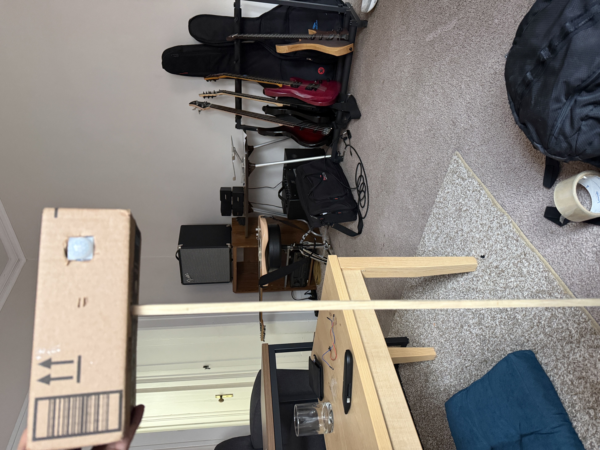
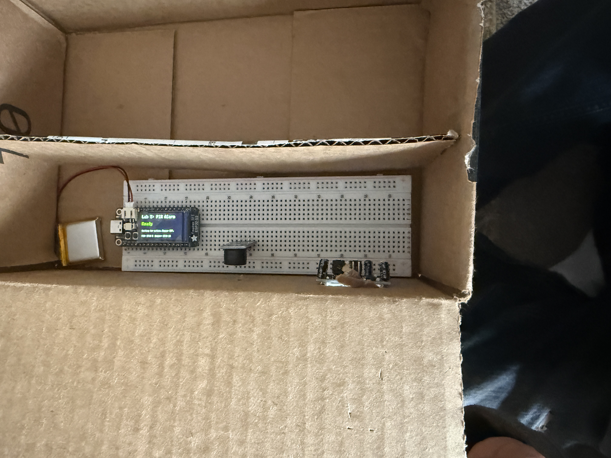
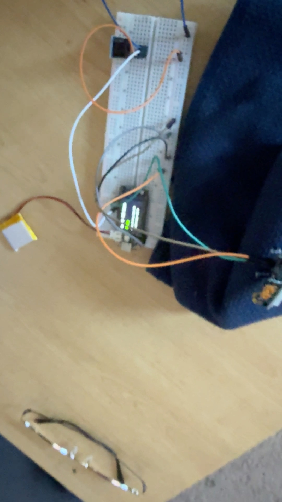
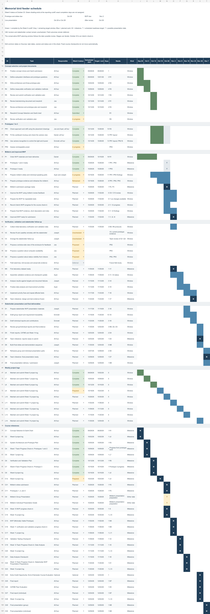
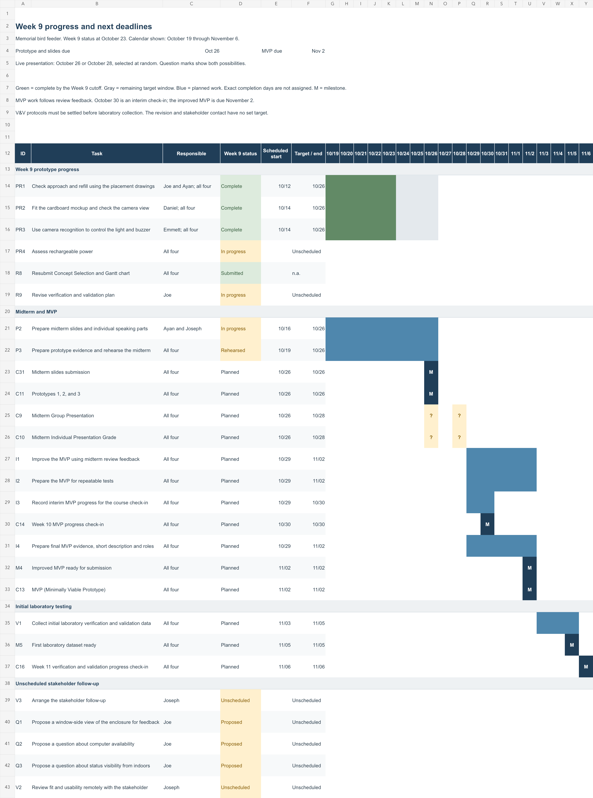

# Week 9 Project Log

**Student:** Joe Falkenburg

**Team role:** Secretary

**Teammates:** Ayan Sheikh, Emmett Gillespie, and Daniel Lim

**Project:** Bird-feeder project

**Stakeholder:** Don Fong

**Reporting period:** October 17 through October 23, 2026

## Project work

We continued building the prototypes and preparing the presentation. There was no new main assignment this week, and the prototype and slide submissions moved to the following Monday. Most of our work was asynchronous. I was excused from Wednesday's class to attend Kevin Kranzusch's talk and reception, and I made up the work.

### Prototype 1: Placement and refill walk-through

We used the placement drawings to step through an animal approaching the feeder, how the system would respond, and how Mr. Fong would refill it. Our earlier drawing work had exposed the tray's obstruction of an under-feeder camera, which helped us choose the separate post.

In the refill scenario, we worked through disabling the response, taking down the feeder, refilling and rehanging it, and restoring operation. The camera and enclosure would stay on their post, with electronics servicing separate from an ordinary refill. We found no substantive change was needed, so we kept the planned sequence.

### Prototype 2: Cardboard enclosure, fit, and camera view

We fitted the real parts into the cardboard mockup, positioning the breadboard and controller, PIR motion sensor, buzzer, and battery while checking the room for them and their connections. We cut the front opening so the PIR's dome could project through the enclosure wall, and used the separate upright to represent the post.

The hardware fit the proposed arrangement without a substantial layout change or a larger enclosure. Fitting it gave us a physical check of the space we had allowed in the drawings, so we could keep that layout as we connected the electronics.

Once we had camera images, we checked the view from the proposed arrangement as well. It was adequate without a meaningful change to the angle, opening, or the post's height or distance. That settled the placement question we had left open during camera debugging. These were checks of the prototype's arrangement; they did not give us measurements of Mr. Fong's actual installation.

*The cardboard enclosure on its separate upright, held in position to show the arrangement.*

*The interior shows the component fit and the battery-connected controller. The camera-view checks and the separate light's operation are not shown in these photos.*

### Prototype 3: Motion response and recognition integration

We used a simplified PIR alarm to check motion sensing and controller behavior on their own. Camera-based recognition remained part of the intended design because motion alone does not identify the animal. In the recorded bench test, the controller goes through its warm-up period, reaches Ready, changes to Motion Detected, and returns to Ready. The board has a battery connected and no USB cable attached.

To keep recognition work moving during camera debugging, we chose the saved-image approach we had discussed in the meeting. Once we had usable camera images, we connected image capture to recognition and used the results to control the light and buzzer automatically.

[View the PIR alarm demonstration](videos/week9-prototype3-pir-demo.mov)

*The clip shows the motion sensor, controller, and alarm-status changes in the simplified PIR test. In our separate integration test, recognition results from actual camera images automatically controlled both the light and buzzer. That test and the separate light's operation are not shown here.*

## Verification and validation revision

I continued work on the V&V revision and am taking ownership of it. The revision is still in progress. Its scope, test procedures, and requirement-tracing tables need to describe the same study and agree on what each result can establish. The plan also has to keep laboratory findings separate from questions that need Mr. Fong's input or observations at his feeder.

The prototype checks give us different evidence to work from: the parts fit, the camera has a usable view, and recognition can command the outputs. We can now test that functioning sequence, but its final accuracy and response-time performance remain to be evaluated. Whether it keeps animals away also remains unproven and needs evidence from the feeder itself.

## Presentation and schedule

We rehearsed the presentation and discussed how the drawings, physical mockup, and electronics could demonstrate the intended response. For the talk, we need to explain what each prototype tested, what we learned, and how those findings informed the next stage.

We resubmitted the Concept Selection and Gantt Chart document. The weekly chart below starts from that version and uses the prototype sequence we have followed. It shows the completed prototype work alongside my ongoing V&V revision and the stakeholder follow-up still to be arranged.

Prototype and slide submissions are due October 26. Our presentation slot will be assigned at random for October 26 or October 28, and the MVP is due November 2. For the MVP, we will use the midterm review feedback to refine the prototype further and prepare it for collecting useful test data.

[Editable Gantt chart](attachments/Week9-Gantt.xlsx)

## Questions to bring to the team

We had no new stakeholder contact or feedback this week. Mr. Fong's earlier feedback continued to guide the work, particularly his concern for the memorial feeder's appearance and his normal refill routine. I identified three questions I want to bring to the team for the next conversation with him.

- Can we show him the current post and enclosure from the direction of his window and ask whether their visibility and position are acceptable? The fit and camera-view checks support the arrangement technically, but we still need his judgment about its appearance, especially given his earlier concern about bulk around the memorial feeder.
- Would he be comfortable leaving a computer available whenever the system is active, or does the eventual system need to operate independently? Our design has allowed recognition on a nearby computer. His general comfort with technology does not tell us whether he wants to maintain that particular setup.
- How would he want to tell, from inside the house, whether the system is operating normally, paused for handling, or needs attention? The display made the bench test's states visible, but it sits inside the enclosure in the photos. We need to establish what he could notice and interpret from his normal viewing position.

## 2026-10-22: Internal team meeting minutes

**Time:** 3:00–3:30 PM · **Platform:** Zoom · **Minutes recorded by:** me (Joe Falkenburg), team secretary

**Attendees (all present):** Joe Falkenburg, Ayan Sheikh, Emmett Gillespie, and Daniel Lim.

- Rehearsed our presentation for the following week.
- Planned to work on the Concept Selection and Gantt Chart resubmission, which was not yet complete.
- Reviewed progress on the drawings, cardboard mockup, and electronics, including the path from motion sensing through camera capture and laptop recognition to the light and buzzer. With no usable camera images yet, getting capture or streaming working was next. We compared developing recognition from saved images during camera debugging with waiting for live images.
- For the presentation, we considered a teammate judging whether a target was a deer and operating the light and buzzer by hand, giving the ESP32 simulated recognition results so it could control the outputs, or explaining the intended response using the drawings and mockup.
- We discussed comparing camera tilt, the camera opening's size and position, and the post's height and distance from the feeder once the camera works. For the enclosure, we considered keeping boards removable with connector access and wire slack, rearranging the boards and breadboard so wiring stays clear of sensor openings, or making the enclosure larger. The recognition approach, demonstration method, and layout changes remained undecided.
- Discussed checking that a confident deer identification at night activates the light and buzzer, and that they stay off for birds, people, unclear images, daytime, missing camera images, and late recognition results.
