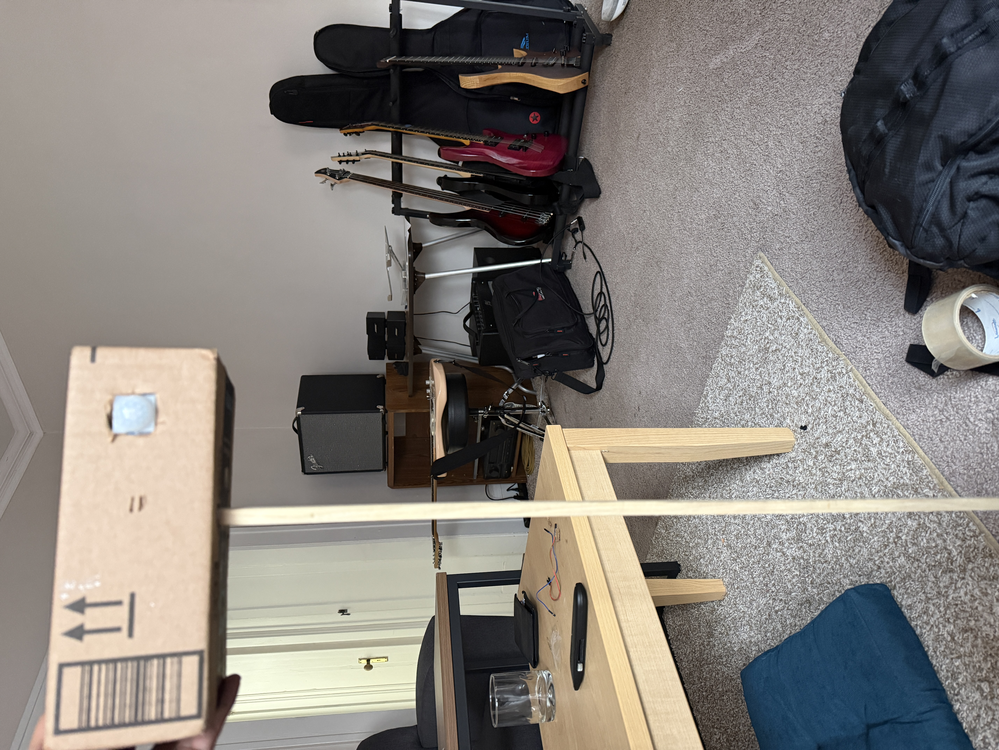
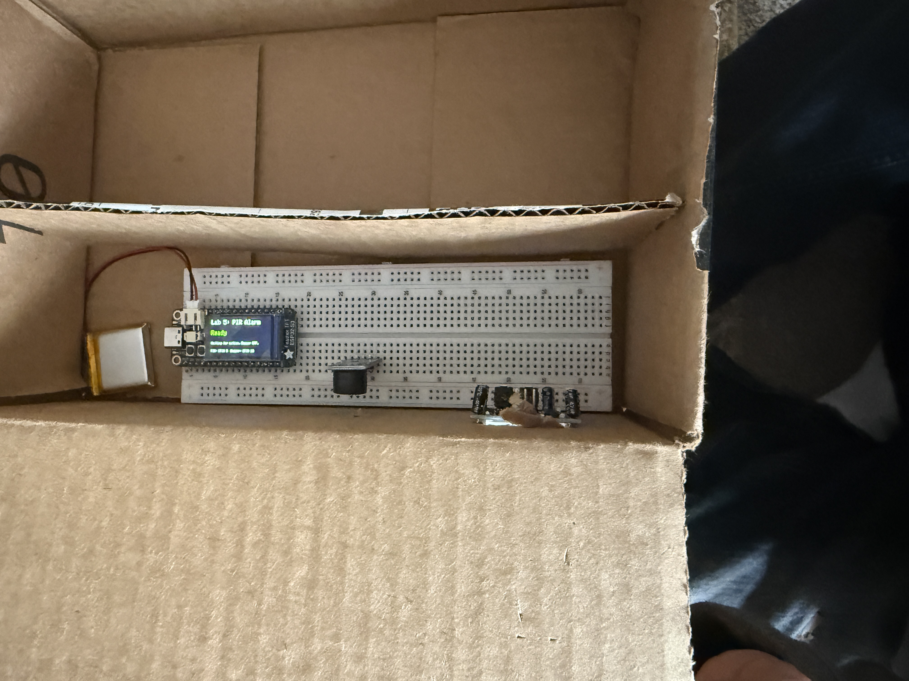
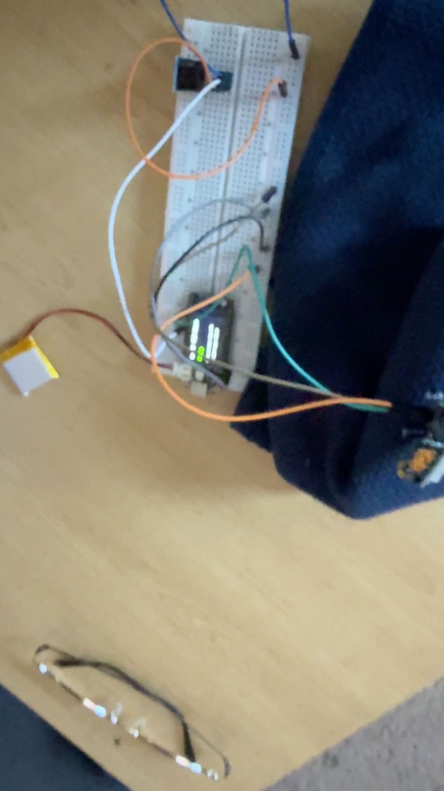
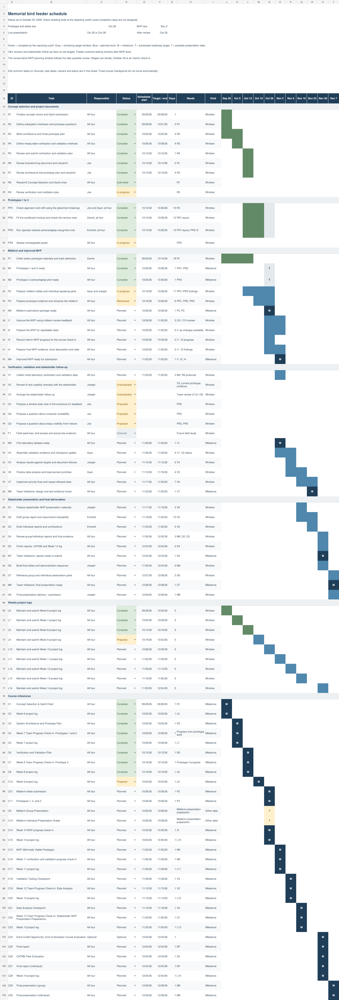
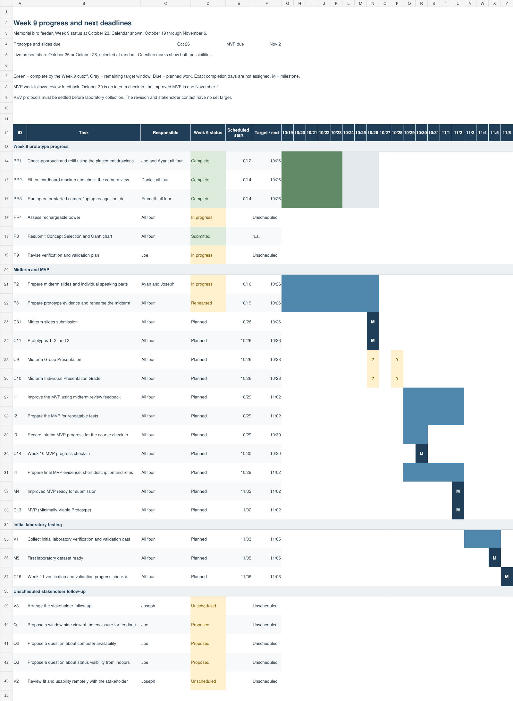

# Week 9 Project Log

**Student:** Joe Falkenburg

**Team role:** Secretary

**Teammates:** Ayan Sheikh, Emmett Gillespie, and Daniel Lim

**Project:** Bird-feeder project

**Stakeholder:** Don Fong

**Reporting period:** October 17 through October 23, 2026

## Project work · October 17–23

We continued building the prototypes and preparing the presentation. There was no new main assignment this week, and the prototype and slide submissions moved to the following Monday. Most of our work was asynchronous. I was excused from Wednesday's class to attend Kevin Kranzusch's talk and reception, and I made up the work.

### Prototype 1: Placement and refill walk-through

We used the placement drawings to step through an animal approaching the feeder, the proposed response, and Mr. Fong's refill routine. The tray's obstruction of an under-feeder camera had already led us to place the camera and enclosure on a separate post.

The refill walk-through covered pausing the response, taking down the feeder, refilling and rehanging it, and restoring operation. The camera and enclosure would remain on their post, keeping electronics servicing separate from an ordinary refill. We retained that planned sequence without a substantive layout change. This was a check of the handling procedure; the usable pause control still needed implementation.

### Prototype 2: Cardboard enclosure, component fit, and camera view

We fitted the real breadboard and controller, PIR motion sensor, buzzer, and battery into the cardboard mockup, checking room for the parts and their connections. The front opening let the PIR dome project through the wall, and a separate upright represented the post. The components fit without a substantial rearrangement or a larger cardboard enclosure, supporting the space allowed in the placement drawings.

Once camera images were available, we also checked the proposed view. It was qualitatively adequate without a meaningful change to the angle, opening, or represented post height and distance. These checks supported the prototype arrangement; they did not establish dimensions, anchoring, or camera coverage at Mr. Fong's actual installation.

*The cardboard enclosure held on its separate upright to check the proposed arrangement.*

*The temporary enclosure provided a component-fit check. Camera-view testing and the separate deterrent light are not shown in these photographs.*

### Prototype 3: Separate motion test and early camera/model pilot

We used a simplified battery-powered PIR alarm to check motion sensing and controller behavior separately. The TFT showed the warm-up period, Ready, Motion Detected, and a return to Ready. This established the motion/status path while camera-based recognition was being developed.

For recognition, we tried an early compact-model approach and another laptop-oriented deer detector. The laptop test program ran a model checkpoint on an individual image and converted its prediction into a response decision. Saved images allowed this work to continue during camera debugging. Once usable camera captures were available, we ran operator-started image trials: the laptop processed a camera image and returned a recognition decision, which made the ESP32-S3 operate the physical light and buzzer automatically. The operator started the trial; the model result controlled the response.

This camera configuration used the battery to power the camera, controller, and outputs, with the separately powered laptop still needed for inference. The TFT was unused in this configuration. Capture relied on ambient lighting, and the project LED served as the deterrent output. PIR-triggered camera acquisition, capture illumination, and the fuller operating controls were not yet joined into this pilot.

The result was a nominal image-to-decision-to-output integration trial. It showed that recognition results could control the hardware, but we had not evaluated recognition accuracy or established dependable continuous operation. The compact-model route remained at an early stage, with further development and performance testing ahead.

[View the PIR alarm demonstration](videos/week9-prototype3-pir-demo.mov)

*The video shows the separate PIR/controller/status test on battery power. The operator-started camera/laptop recognition trial and its automatic light and buzzer response were separate experiments and are not shown in this clip.*

## Verification and validation revision · October 17–23

I continued work on the V&V revision and am taking ownership of it. The revision is still in progress. Its scope, test procedures, and requirement-tracing tables need to describe the same study and agree on what each result can establish. The plan also has to keep laboratory findings separate from questions that need Mr. Fong's input or observations at his feeder.

The prototype work established component fit, a usable camera view, and a basic recognition-result connection to the outputs. Recognition quality, response-time performance, complete operating policies, and battery endurance still needed evaluation. Whether the response would actually deter animals remained a separate feeder-level question.

## Presentation and schedule · October 17–23

We rehearsed the presentation and discussed how the drawings, physical mockup, and electronics could explain each prototype's purpose, test, finding, and next step. We also resubmitted the Concept Selection and Gantt Chart document. The updated schedule distinguishes the completed prototype trials from my ongoing V&V revision, fuller integration, and stakeholder follow-up still to be arranged.

Prototype and slide submissions are due October 26. Our presentation slot will be assigned at random for October 26 or October 28, and the MVP is due November 2. Midterm feedback will guide the next prototype iteration and preparation for useful testing.

[Editable project Gantt chart](attachments/Project-Gantt.xlsx)

## Questions to bring to the team · October 17–23

There was no new stakeholder contact this week. Mr. Fong's earlier feedback continued to guide the work, particularly the memorial feeder's appearance and his normal refill routine. I identified three questions for the next team discussion about stakeholder follow-up.

- Can the current post and enclosure be shown from the direction of his window so he can judge their visibility and position? The prototype checks support the arrangement technically, but appearance remains his judgment.
- Would he be comfortable leaving a computer available whenever the system is active, or should ordinary operation be independent of it? The current camera pilot still requires laptop inference.
- How would he want to tell from inside the house whether the system is operating, paused, or needs attention? The TFT made the PIR bench states visible, but the display's usefulness from his normal viewing position remains unresolved.

## 2026-10-22: Internal team meeting minutes

**Time:** 3:00–3:30 PM · **Platform:** Zoom · **Minutes recorded by:** me (Joe Falkenburg), team secretary

**Attendees (all present):** Joe Falkenburg, Ayan Sheikh, Emmett Gillespie, and Daniel Lim.

- Rehearsed our presentation for the following week and planned to work on the Concept Selection and Gantt Chart resubmission, which was not yet complete at the meeting.
- Reviewed progress on the drawings, cardboard mockup, and electronics, including the proposed motion-to-camera-to-laptop-recognition-to-output path. Usable camera images were not yet available at the meeting. We compared developing recognition with saved images during camera debugging with waiting for live captures.
- For the presentation, we considered manually judging a target and operating the outputs, supplying simulated recognition decisions to the controller, or explaining the intended response through the drawings and mockup. These remained alternatives under discussion.
- We discussed checking camera tilt, opening size and position, and post height and distance once images were available. For the enclosure, we considered removable boards, connector access and wire slack, rearranging components to keep wiring clear of sensor openings, or increasing enclosure size. The recognition approach, demonstration method, and layout changes remained undecided at the meeting.
- Discussed checking that a confident deer identification at night activates the response and that outputs stay off for birds, people, unclear or missing images, daytime, and late recognition results. These were requirements to implement and verify.
